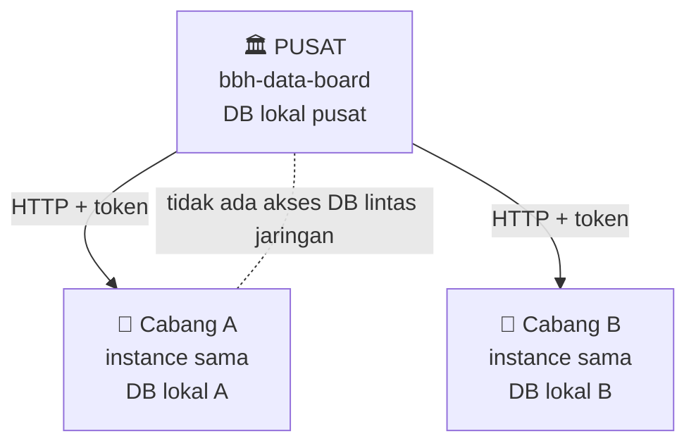

# SPEC: Federated Branch Endpoints

## 1. Konteks & Keputusan Arah

**Arah lama (dibatalkan):** multi-database terpusat — pusat mengakses DB cabang secara langsung via `db_registry`. Seluruh artefaknya sudah dihancurkan (WO-15 destroy: rollback migrasi, potong commit ke `1f5a9b2`, hapus topic `1792765876397`).

**Arah baru (dokumen ini):** federasi instance.

> Pusat dan cabang menjalankan **aplikasi yang sama**. Dari pusat, pengguna bisa **mengganti endpoint** ke API service milik cabang. Autentikasi lintas instance (SSO) menyusul.

### Bentuk sistem



## 1b. Dua Jalur API di SPA (kontrak inti)

SPA (`sub_app/webapp`) **tidak berubah** dan tetap satu deployment bersama pusat. Di dalamnya ada **dua jalur API** dengan perilaku berbeda:

| Jalur | Target | Berpindah? | Contoh |
|---|---|---|---|
| **Auth** — login, sesi, identitas | **Pusat** (instance pemilik dashboard) | ❌ Tidak pernah | `POST /api/auth/login` |
| **Core business** — POS, inventory, transaksi | **Endpoint cabang yang dipilih** | ✅ **Inilah yang di-gantikan** | endpoint dengan `purpose=business` |

### Alur "Captive Portal ke Cabang" (kontrak utama)

```
1. Admin login di dashboard pusat            → auth pusat, dapat access_token PUSAT
2. Dashboard menampilkan daftar portal cabang (dari endpoint registry)
3. Admin memilih "Masuk ke Cabang JKT"       → captive portal
4. SSO: dashboard menukar identitas ke cabang → dapat access_token CABANG
5. Dashboard RELOAD                          → menu diarahkan ulang (lihat peta menu)
6. Request business berikutnya                → ke API service cabang, pakai token CABANG
7. "Keluar" / pilih portal pusat              → kembali ke mode pusat
```

**Prinsip kunci:** *auth pusat tetap; hanya API business yang digantikan. Saat masuk portal, sesi memegang **dua token** — `main token` (pusat) dan `portal token` (cabang) — dan setiap menu memakai token yang sesuai.*

### Dua Token

| Token | Asal | Dipakai untuk | Dibuang saat |
|---|---|---|---|
| **`main token`** | Login pusat (`POST /api/auth/login`) | List Portal, Profil Pusat, semua route milik pusat | Logout total |
| **`portal token`** | SSO saat masuk portal cabang | Menu business, Profil Cabang, semua route milik endpoint | Keluar portal (D-15) |

Aturan: **tidak pernah tertukar.** `main token` tidak dikirim ke endpoint cabang; `portal token` tidak dikirim ke pusat. Endpoint `test` di WO-01 memakai kredensial service (bukan kedua token ini).

### Peta menu setelah masuk portal cabang

Setelah reload, menu diarahkan ulang — **kecuali dua hal**:

| Menu | Setelah masuk portal | Token yang dipakai |
|---|---|---|
| Menu business (POS, inventory, transaksi, laporan) | ➡️ **Point ke cabang** | token **cabang** |
| **List Portal** (daftar/berpindah portal) | 🏠 **Tetap pusat** | token **pusat** |
| **Admin Profile** | 🏠 **Dua versi** (pusat & cabang) | sesuai versi yang dibuka |

**Aturan:**
- **List Portal selalu ke pusat.** Kalau ia ikut berpindah, admin terkunci di cabang tanpa jalan keluar. Ini jalur keluar dari captive portal — ia **tidak boleh** bergantung pada instance tujuan.
- **Admin Profile punya dua versi**, dan admin boleh melihat **datanya masing-masing**:
  - **Profil Pusat** → dibaca dari instance pusat (peran pusat).
  - **Profil Cabang** → dibaca dari instance cabang (peran lokal cabang dari SSO).
  - Keduanya boleh **berbeda** (mis. admin di pusat, kasir di cabang). Sistem menampilkan keduanya apa adanya; **tidak** memaksa keduanya sama.
- Menu yang tidak jelas kepemilikannya → **default ke pusat** sampai ada penetapan eksplisit. Lebih baik menu kembali ke pusat daripada memanggil endpoint yang tidak melayani route tersebut.

Konsekuensi:
- Endpoint registry menaungi **API business** (`purpose=business`).
- Setiap route perlu **penetapan pemilik**: `local` (pusat) atau `endpoint` (cabang). Lihat D-13.
- SPA menyimpan di `localStorage`: `access_token` pusat, `access_token` cabang (bila ada), dan portal aktif.
- **CORS** didaftarkan eksplisit per instance (daftar origin, bukan wildcard).
- **Pendaftaran user di cabang** diperlukan agar SSO bekerja (lihat Fase 3).

## 2. Keputusan (D-1..D-15)

| # | Keputusan | Alasan |
|---|---|---|
| **D-1** | Satu basis kode, banyak instance. Tiap instance (pusat & cabang) punya DB lokal sendiri + plugin `auth` sendiri. | Deploy seragam; cabang mandiri. |
| **D-2** | Pusat **tidak pernah** membuka koneksi DB ke cabang. Komunikasi hanya HTTP API. | Tidak ada kredensial DB lintas jaringan; port DB cabang tidak perlu terbuka. |
| **D-3** | Daftar endpoint cabang disimpan di **DB lokal pusat**, tabel `endpoints`, dibuat lewat **migrasi versioned**. | Konsisten dengan kontrak yang sudah terbukti: skema milik DB utama → harus lewat migrasi, bukan DDL bootstrap. |
| **D-4** | "Ganti cabang" = **ganti base URL + kredensial API** untuk core business **dan** auth cabang, bukan ganti koneksi DB. | Model federasi. |
| **D-5** | Registry endpoint **tidak menyimpan password DB**. Yang disimpan hanya base URL, label, status, `purpose`, dan referensi token. | Mengurangi permukaan risiko; token disegel (AES-GCM) seperti pola `secrets` yang ada. |
| **D-6** | Hanya **satu endpoint aktif** dalam satu waktu per sesi/instance (bukan multi-target bersamaan). Default = instance itu sendiri (`local`). | Menghindari ambiguitas "request ini ke mana". |
| **D-7** | Endpoint aktif dapat di-override **per request** lewat header `X-Branch-Endpoint`, atau di-set sebagai **mode kerja** lewat CLI/API. | Fleksibilitas untuk dashboard pusat + skrip. |
| **D-8** | **SSO lintas instance (fase 3 — DIPERLUKAN, **scope: ADMIN saja**):** setiap instance menjalankan plugin `auth` sendiri. Pusat menerbitkan token identitas; cabang memverifikasinya **lokal** (shared secret/public key, tanpa callback) **dan** hanya menerima **admin** yang **sudah terdaftar di `admins` cabang** tersebut. Belum terdaftar → **403** dengan pesan jelas. Peran dipetakan ke peran lokal cabang. **User `members` di luar ruang lingkup federasi saat ini** (ditunda, bukan dihapus). | Federated identity + pendaftaran lokal; cabang tetap berdaulat atas user-nya; ruang lingkup diperkecil ke admin dulu agar sederhana. |
| **D-9** | Setiap request lintas instance wajib membawa **request ID** dan dicatat di audit log pusat (endpoint, metode, path, status, durasi — **tanpa body/token**). | Ketertelusuran tanpa membocorkan data. |
| **D-10** | Gagal koneksi ke endpoint **tidak boleh** membuat pusat error total: kembalikan error terklasifikasi (`unreachable`, `unauthorized`, `timeout`, `bad_gateway`) + cadangan ke `local` bila dikonfigurasi. | Ketahanan operasional. |
| **D-11** | **Semua instance identik.** "Pusat" bukan role di kode — ia hanyalah **instance yang mendaftarkan endpoint lain** di tabel `endpoints` miliknya. Setiap instance dapat bertindak sebagai pusat bagi instance lain. | Simetri; tidak ada mode khusus yang perlu di-hard-code. |
| **D-12** | **Anti-loop:** request lintas instance maksimum **1 hop**. Instance menolak meneruskan request yang sudah membawa `X-Forwarded-Instance` (sudah berasal dari instance lain). | Mencegah A→B→A→B berputar; mencegah eskalasi tak terbatas. |
| **D-13** | **Pemilik route wajib eksplisit.** Setiap route/menu ditetapkan pemiliknya: `local` (instance dashboard/pusat) atau `endpoint` (instance tujuan). **List Portal** dan **login** selalu `local`; menu business `endpoint`. Route tanpa penetapan → default `local`. | Tanpa penetapan eksplisit, route acak berpindah dan admin bisa terkunci di cabang. |
| **D-14** | **Sesi portal memegang DUA token:** **`main token`** (dari login pusat — untuk List Portal + Profil Pusat) dan **`portal token`** (dari SSO cabang — untuk menu business + Profil Cabang). **Admin Profile punya dua versi** (pusat & cabang) dan boleh **berbeda**; sistem menampilkan keduanya, tidak memaksa sama. | Profil & peran pusat ≠ cabang; admin berhak melihat kedua datanya. |
| **D-15** | **Dua token, dua peran, tidak pernah tertukar.** `main token` **hanya** untuk route milik pusat; `portal token` **hanya** untuk route milik endpoint. Keluar portal **membuang `portal token`** (bukan hanya mengganti base URL) dan mengembalikan semua menu ke pusat. Token tidak boleh digunakan lintas peran. | Mencegah token kadaluarsa/peran lama tertinggal dan mencegah eskalasi lintas instance. |

## 3. Ruang Lingkup

### Fase 1 — Endpoint Registry (WO-01)

- Tabel `endpoints` + `endpoint_audit` via migrasi versioned.
- CLI: `endpoint add | list | rm | test | use | active`.
- API admin: CRUD + `POST /api/admin/endpoints/:key/test`.
- Token endpoint disegel AES-GCM.
- Audit request lintas instance.

### Fase 2 — Captive portal & routing business per request (WO-02)

- **Captive portal di dashboard admin pusat**: daftar endpoint cabang + tombol "Masuk ke Cabang" / "Keluar ke local".
- API bisnis **digantikan**: setelah masuk cabang, seluruh request `purpose=business` diarahkan ke base URL cabang.
- HTTP client terpusat yang bisa dialihkan targetnya.
- Override per request via header `X-Branch-Endpoint`.
- **Anti-loop (D-12):** kirim `X-Forwarded-Instance`; tolak request yang sudah membawanya.
- Klasifikasi error (`unreachable`/`timeout`/`unauthorized`/`bad_gateway`) + fallback `local`.
- Audit log request lintas instance.

### Fase 3 — SSO lintas instance + pendaftaran lokal (WO-03, DIPERLUKAN)

- Pusat menerbitkan token identitas (klaim: `iss`, `sub`, `email`, `role`, `aud`, `exp`).
- Cabang memverifikasi token **secara lokal** (shared secret fase awal → public key bila perlu rotasi).
- **Guard keanggotaan lokal (admin saja):** cabang menolak admin yang belum ada di `admins` cabang (403 dengan pesan jelas). `members` tidak disentuh fase ini.
- Pemetaan peran pusat → peran lokal cabang.
- **Pendaftaran admin di cabang:** proses/prosedur agar admin pusat terdaftar di `admins` cabang (pilih mekanisme: manual oleh admin cabang, atau sinkronisasi bertahap) — diputuskan di WO-03. **Hanya admin; members di luar ruang lingkup.**
- `aud` mencegah token satu cabang dipakai di cabang lain.

### Di luar ruang lingkup

- Sinkronisasi/penggabungan data antar cabang (laporan gabungan) — belum ada kebutuhan terkonfirmasi.
- Replikasi, sharding, HA.
- Frontend dashboard pemilihan cabang (menyusul setelah API stabil).
- **User `members`**: federasi/SSO saat ini **hanya untuk admin**. Jalur member (login member lintas instance, pendaftaran member di cabang) ditunda — diteruskan ke WO/fase berikutnya bila dibutuhkan. Tabel `members` tetap ada dan berfungsi normal per instance.
- **SPA (`sub_app/webapp`)**: halaman/menu **tidak berubah**; hanya modul API client (`client.ts`) perlu dukungan dua token (`main`/`portal`) — perubahan terbatas, bukan redesign.

## 4. Model Data Usulan (Fase 1)

```sql
CREATE TABLE endpoints (
    id            BIGSERIAL PRIMARY KEY,
    key           TEXT UNIQUE NOT NULL,      -- "local", "cabang-jkt", "cabang-smg"
    label         TEXT,
    base_url      TEXT NOT NULL,             -- https://cabang-jkt.example.com
    purpose       TEXT NOT NULL DEFAULT 'business', -- business (auth TIDAK didaftarkan di sini)
    auth_kind     TEXT NOT NULL DEFAULT 'none',  -- none | bearer (fase 3: hmac/jwt)
    token_enc     TEXT,                      -- AES-GCM envelope, NULL bila auth_kind=none
    timeout_ms    INT  NOT NULL DEFAULT 10000,
    status        TEXT NOT NULL DEFAULT 'active', -- active | suspended
    is_local      BOOLEAN NOT NULL DEFAULT FALSE, -- penanda instance sendiri
    created_at    TIMESTAMPTZ NOT NULL DEFAULT NOW(),
    updated_at    TIMESTAMPTZ NOT NULL DEFAULT NOW()
);

CREATE TABLE endpoint_audit (
    id            BIGSERIAL PRIMARY KEY,
    endpoint_key  TEXT NOT NULL,
    request_id    TEXT NOT NULL,
    method        TEXT NOT NULL,
    path          TEXT NOT NULL,
    status_code   INT,
    duration_ms   INT,
    error_class   TEXT,                      -- unreachable|timeout|unauthorized|bad_gateway|NULL
    created_at    TIMESTAMPTZ NOT NULL DEFAULT NOW()
);
CREATE INDEX idx_endpoint_audit_key_time ON endpoint_audit (endpoint_key, created_at DESC);
```

## 5. Kriteria Penerimaan (Fase 1)

| # | AC |
|---|---|
| AC-1 | `endpoint add --key cabang-jkt --base-url https://... --label "Cabang Jakarta"` mendaftarkan endpoint; token (bila ada) tersimpan tersegel AES-GCM, tidak pernah tampil di output/log. |
| AC-2 | `endpoint list` menampilkan key, label, base URL, status, dan **penanda endpoint aktif**. |
| AC-3 | `endpoint test --key cabang-jkt` memanggil health endpoint cabang dan melaporkan sukses/gagal **beserta sebab yang dapat ditindaklanjuti** (unreachable/timeout/401/5xx), plus durasi. |
| AC-4 | `endpoint use cabang-jkt` mengubah endpoint aktif; `endpoint use local` kembali ke instance sendiri. |
| AC-5 | Request dengan header `X-Branch-Endpoint: cabang-jkt` diarahkan ke endpoint tersebut; tanpa header memakai endpoint aktif. |
| AC-6 | Endpoint nonaktif (`suspended`) ditolak dengan error jelas. |
| AC-7 | Setiap request lintas instance tercatat di `endpoint_audit` (request_id, method, path, status, durasi) **tanpa body maupun token**. |
| AC-8 | `endpoint rm` menolak menghapus endpoint yang sedang aktif / `is_local`. |
| AC-9 | Kegagalan endpoint tidak membuat proses pusat crash; error terklasifikasi dikembalikan. |
| AC-10 | Skema dibuat lewat migrasi versioned; `CREATE TABLE` nol di kode Go. |

### Kriteria Penerimaan Fase 2 (Captive Portal & Routing)

| # | AC |
|---|---|
| AC-16 | Memilih "Masuk ke Cabang JKT" melakukan **SSO** dan sesi memegang token **cabang**; dashboard reload dengan menu business menunjuk ke cabang. |
| AC-17 | Setelah masuk portal, **List Portal tetap menunjuk pusat** dan tetap berfungsi untuk berpindah/keluar portal. |
| AC-18 | **Admin Profile** tersedia dalam **dua versi** (pusat & cabang) dan boleh menampilkan data yang **berbeda**; membuka salah satu tidak merusak yang lain. |
| AC-19 | Route yang tidak ditetapkan pemiliknya **default ke pusat** (tidak pernah diam-diam ke cabang). |
| AC-20 | Request yang sudah membawa `X-Forwarded-Instance` **ditolak** (anti-loop D-12). |
| AC-21 | Sesi memegang **dua token**: `main token` + `portal token`. `main token` **tidak pernah** dikirim ke endpoint cabang; `portal token` **tidak pernah** dikirim ke pusat. |
| AC-22 | Keluar portal **membuang `portal token`** dan mengembalikan seluruh menu ke pusat; `main token` tetap utuh. |

### Kriteria Penerimaan Fase 3 (SSO lintas instance)

| # | AC |
|---|---|
| AC-11 | **Admin** yang login di pusat dapat mengakses cabang **tanpa login ulang**, bila **sudah terdaftar di `admins` cabang** tersebut. |
| AC-12 | **Admin** yang **belum terdaftar di cabang** ditolak dengan **403 + pesan jelas** (bukan 401), meskipun tokennya sah. |
| AC-13 | Cabang memverifikasi token **secara lokal** — tidak ada callback ke pusat pada setiap request (dibuktikan: pusat dimatikan, token valid tetap diterima cabang). |
| AC-14 | Token ber-`aud` cabang lain **ditolak** di cabang ini. |
| AC-15 | Password pengguna **tidak pernah** disimpan/dipindahkan ke cabang untuk user SSO. |

## 6. Risiko & Mitigasi

| Risiko | Mitigasi |
|---|---|
| Token endpoint bocor di log | Envelope AES-GCM (pola `internal/secrets` yang sudah ada); audit hanya mencatat metadata; test wajib grep log. |
| Latensi antar cabang | Timeout per endpoint (default 10s) + durasi tercatat di audit. |
| Data terbelah antar cabang (tidak ada laporan gabungan) | Diterima pada fase 1; dicatat sebagai batasan eksplisit, bukan bug. |
| Instability karena menambah lapisan HTTP | Endpoint `local` selalu tersedia sebagai jalur langsung tanpa hop. |

## 7. Hubungan dengan Kode yang Ada

| Komponen | Status |
|---|---|
| Plugin `auth` + JWT | **Fondasi SSO fase 3** — diperluas dengan klaim `iss`/`aud`/`email` dan mode verifikasi lokal di cabang. Setiap instance memakai plugin ini atas DB-nya sendiri. |
| `internal/migration` (versioned) | Dipakai ulang untuk migrasi `endpoints`. |
| `internal/secrets` (AES-GCM) | Dipakai ulang untuk `token_enc`. |
| `internal/console` (CLI) | Tempat command `endpoint ...`. |
| Guard `--connection` | Tidak relevan untuk endpoint; guard tetap untuk migrasi. |
