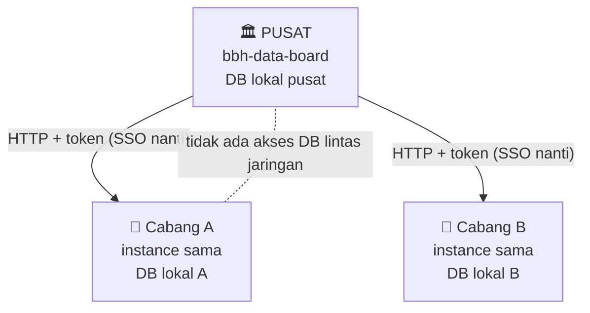

# SPEC: Federated Branch Endpoints

## 1. Konteks & Keputusan Arah

**Arah lama (dibatalkan):** multi-database terpusat — pusat mengakses DB cabang secara langsung via `db_registry`. Seluruh artefaknya sudah dihancurkan (WO-15 destroy: rollback migrasi, potong commit ke `1f5a9b2`, hapus topic `1792765876397`).

**Arah baru (dokumen ini):** federasi instance.

> Pusat dan cabang menjalankan **aplikasi yang sama**. Dari pusat, pengguna bisa **mengganti endpoint** ke API service milik cabang. Autentikasi lintas instance (SSO) menyusul.

### Bentuk sistem



## 2. Keputusan (D-1..D-10)

| # | Keputusan | Alasan |
|---|---|---|
| **D-1** | Satu basis kode, banyak instance. Tiap instance punya DB lokal sendiri (PostgreSQL). | Deploy seragam, cabang mandiri. |
| **D-2** | Pusat **tidak pernah** membuka koneksi DB ke cabang. Komunikasi hanya HTTP API. | Tidak ada kredensial DB lintas jaringan; port DB cabang tidak perlu terbuka. |
| **D-3** | Daftar endpoint cabang disimpan di **DB lokal pusat**, tabel `endpoints`, dibuat lewat **migrasi versioned**. | Konsisten dengan kontrak yang sudah terbukti: skema milik DB utama → harus lewat migrasi, bukan DDL bootstrap. |
| **D-4** | "Ganti cabang" = **ganti base URL + kredensial API**, bukan ganti koneksi DB. | Model federasi. |
| **D-5** | Registry endpoint **tidak menyimpan password DB**. Yang disimpan hanya base URL, label, status, dan referensi token. | Mengurangi permukaan risiko; token pun disegel (AES-GCM) seperti pola `secrets` yang ada. |
| **D-6** | Hanya **satu endpoint aktif** dalam satu waktu per sesi/instance (bukan multi-target bersamaan). Default = instance itu sendiri (`local`). | Menghindari ambiguitas "request ini ke mana". Bisa dilonggarkan nanti bila perlu. |
| **D-7** | Endpoint aktif dapat di-override **per request** lewat header `X-Branch-Endpoint`, atau di-set sebagai **mode kerja** lewat CLI/API. | Fleksibilitas untuk dashboard pusat + skrip. |
| **D-8** | **SSO (fase 2):** pusat menerbitkan JWT; cabang memverifikasi dengan shared secret/public key. Fase 1 hanya menyiapkan tempat (kolom + interface), belum membangun alur login lintas instance. | Bertahap; fase 1 harus berguna tanpa SSO. |
| **D-9** | Setiap request lintas instance wajib membawa **request ID** dan dicatat di audit log pusat (endpoint, metode, path, status, durasi — **tanpa body/token**). | Ketertelusuran tanpa membocorkan data. |
| **D-10** | Gagal koneksi ke endpoint **tidak boleh** membuat pusat error total: kembalikan error terklasifikasi (`unreachable`, `unauthorized`, `timeout`, `bad_gateway`) + cadangan ke `local` bila dikonfigurasi. | Ketahanan operasional. |

## 3. Ruang Lingkup

### Fase 1 — Endpoint Registry & Switching (WO-01, WO-02)

- Tabel `endpoints` + migrasi versioned (plugin baru atau perluasan plugin yang ada).
- CLI: `endpoint add | list | rm | test | use`.
- API admin: CRUD + `POST /api/admin/endpoints/:key/test`.
- HTTP client terpusat yang bisa dialihkan targetnya.
- Audit log request lintas instance.

### Fase 2 — SSO (WO-03, belum dijadwalkan)

- Pusat menerbitkan token; cabang memverifikasi.
- Penukaran/verifikasi identitas antar instance.
- Pemetaan peran pengguna pusat → cabang.

### Di luar ruang lingkup

- Sinkronisasi/penggabungan data antar cabang (laporan gabungan) — belum ada kebutuhan terkonfirmasi.
- Replikasi, sharding, HA.
- Frontend dashboard pemilihan cabang (menyusul setelah API stabil).

## 4. Model Data Usulan (Fase 1)

```sql
CREATE TABLE endpoints (
    id            BIGSERIAL PRIMARY KEY,
    key           TEXT UNIQUE NOT NULL,      -- "pusat", "cabang-jkt", "cabang-smg"
    label         TEXT,
    base_url      TEXT NOT NULL,             -- https://cabang-jkt.example.com
    auth_kind     TEXT NOT NULL DEFAULT 'none',  -- none | bearer | hmac (fase2)
    token_enc     TEXT,                      -- AES-GCM envelope, NULL bila auth_kind=none
    timeout_ms    INT  NOT NULL DEFAULT 10000,
    status        TEXT NOT NULL DEFAULT 'active', -- active | suspended
    is_local      BOOLEAN NOT NULL DEFAULT FALSE, -- penanda instance sendiri
    created_at    TIMESTAMPTZ NOT NULL DEFAULT NOW(),
    updated_at    TIMESTAMPTZ NOT NULL DEFAULT NOW()
);

CREATE TABLE endpoint_audit (
    id            BIGSERIAL PRIMARY KEY,
    endpoint_key  TEXT NOT NULL,
    request_id    TEXT NOT NULL,
    method        TEXT NOT NULL,
    path          TEXT NOT NULL,
    status_code   INT,
    duration_ms   INT,
    error_class   TEXT,                      -- unreachable|timeout|unauthorized|bad_gateway|NULL
    created_at    TIMESTAMPTZ NOT NULL DEFAULT NOW()
);
CREATE INDEX idx_endpoint_audit_key_time ON endpoint_audit (endpoint_key, created_at DESC);
```

## 5. Kriteria Penerimaan (Fase 1)

| # | AC |
|---|---|
| AC-1 | `endpoint add --key cabang-jkt --base-url https://... --label "Cabang Jakarta"` mendaftarkan endpoint; token (bila ada) tersimpan tersegel AES-GCM, tidak pernah tampil di output/log. |
| AC-2 | `endpoint list` menampilkan key, label, base URL, status, dan **penanda endpoint aktif**. |
| AC-3 | `endpoint test --key cabang-jkt` memanggil health endpoint cabang dan melaporkan sukses/gagal **beserta sebab yang dapat ditindaklanjuti** (unreachable/timeout/401/5xx), plus durasi. |
| AC-4 | `endpoint use cabang-jkt` mengubah endpoint aktif; `endpoint use local` kembali ke instance sendiri. |
| AC-5 | Request dengan header `X-Branch-Endpoint: cabang-jkt` diarahkan ke endpoint tersebut; tanpa header memakai endpoint aktif. |
| AC-6 | Endpoint nonaktif (`suspended`) ditolak dengan error jelas. |
| AC-7 | Setiap request lintas instance tercatat di `endpoint_audit` (request_id, method, path, status, durasi) **tanpa body maupun token**. |
| AC-8 | `endpoint rm` menolak menghapus endpoint yang sedang aktif / `is_local`. |
| AC-9 | Kegagalan endpoint tidak membuat proses pusat crash; error terklasifikasi dikembalikan. |
| AC-10 | Skema dibuat lewat migrasi versioned; `CREATE TABLE` nol di kode Go. |

## 6. Risiko & Mitigasi

| Risiko | Mitigasi |
|---|---|
| Token endpoint bocor di log | Envelope AES-GCM (pola `internal/secrets` yang sudah ada); audit hanya mencatat metadata; test wajib grep log. |
| Latensi antar cabang | Timeout per endpoint (default 10s) + durasi tercatat di audit. |
| Data terbelah antar cabang (tidak ada laporan gabungan) | Diterima pada fase 1; dicatat sebagai batasan eksplisit, bukan bug. |
| Instability karena menambah lapisan HTTP | Endpoint `local` selalu tersedia sebagai jalur langsung tanpa hop. |

## 7. Hubungan dengan Kode yang Ada

| Komponen | Status |
|---|---|
| Plugin `auth` + JWT | **Fondasi SSO fase 2** — dipertahankan. |
| `internal/migration` (versioned) | Dipakai ulang untuk migrasi `endpoints`. |
| `internal/secrets` (AES-GCM) | Dipakai ulang untuk `token_enc`. |
| `internal/console` (CLI) | Tempat command `endpoint ...`. |
| Guard `--connection` | Tidak relevan untuk endpoint; guard tetap untuk migrasi. |
