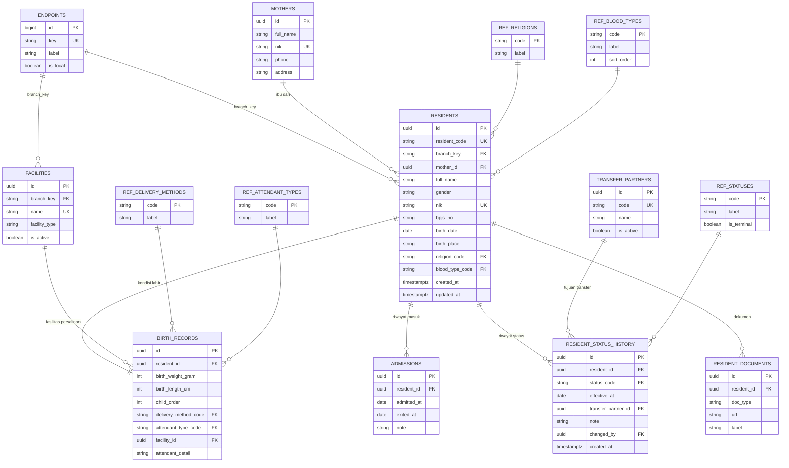

# SPEC: ERD Data Core — Residents (Bayi) BBH

## 1. Konteks & Tujuan

**Latar:** BBH (Bali Baby Home) memiliki **5 cabang**. Tiap cabang merekam data dengan cara/format berbeda. Sistem ini bertujuan menjadi **"titik tengah"** — satu standar (SOP) yang membuat data lintas cabang **comparable** dan **terkelola**.

**Data core pertama:** data **bayi terlantar**. Data lain menyusul (keuangan, kunjungan, kebutuhan) dan tidak dibahas di SPEC ini.

**Sumber acuan:** `Data Bayi Yayasan 1b590f1a8a518093ac5bd1d366590b33_all.csv` — ekspor Notion, 50 baris, 23 kolom, ada BOM. Analisa lengkap ada di `notes.md` topic ini.

**Ruang lingkup SPEC ini:** **desain ERD + definisi tabel** saja. Tidak termasuk implementasi Go, migrasi, handler, maupun UI.

**Selaras arsitektur existing:** multi-instance per cabang, DB lokal per instance, fitur baru wajib berupa plugin (`plugins/<id>/`).

## 2. Prinsip Desain

| # | Prinsip | Konsekuensi |
|---|---|---|
| P-1 | **Canonical schema** adalah kontrak. Semua cabang memetakan ke sini. | Nama field & enum **baku**, tidak mengikuti istilah cabang. |
| P-2 | **"Titik tengah" = super-set kolom, wajib minimum eksplisit.** Kolom dari cabang mana pun ditampung; field wajib ditetapkan tegas (`NOT NULL`). | Tidak ada data cabang yang hilang; kualitas terjaga di field inti. |
| P-3 | **Nilai di-enumerasi, bukan hanya kolom.** Istilah yang berbeda tetapi bermakna sama harus dipetakan ke satu nilai baku. | Ada tabel referensi / nilai enum baku. |
| P-4 | **Lifecycle dipisahkan dari atribut.** Status hunian adalah kejadian berwaktu, bukan kolom statis. | Tabel `resident_status_history`. |
| P-5 | **Identitas ganda:** kode lama (Notion) dipertahankan, PK internal UUIDv7. | `resident_code` unik dan stabil; `id` UUIDv7. |
| P-6 | **PII diperlakukan khusus.** NIK/BPJS/nama ibu bersifat sensitif. | Ditandai di SPEC; penanganan (enkripsi/masking) ditetapkan sebelum implementasi. |
| P-7 | **Skema via migrasi versioned.** Tidak ada `CREATE TABLE` di kode Go. | Konsisten dengan plugin existing. |
| P-8 | **Nama kolom Bahasa Inggris**, nilai enum Bahasa Indonesia (bila istilah domain). | Konsisten lintas plugin; nilai domain tetap dikenali pengguna. |
| P-9 | **Data derived tidak disimpan.** | `age` dihitung dari `birth_date`; tidak ada kolom `umur`. |
| P-10 | **Branch adalah dimensi** = `endpoint`/`INSTANCE_KEY`, **bukan tabel baru**. | Tidak ada tabel `branches`; `residents.branch_key` merujuk `endpoints.key`. |
| P-11 | **Semua data core dibungkus satu plugin `resident`.** | Fitur baru wajib plugin (`plugins/<id>/`), bukan `internal/`. |
| P-12 | **Tabel referensi `ref_*` tinggal di dalam plugin `resident` dulu.** | Pindah ke plugin `reference` hanya bila muncul konsumen kedua. |
| P-13 | **Satu sumber kebenaran definisi field.** Migrasi, template, dropdown, dan validator di-generate dari definisi field yang sama. | Template & validator tidak bisa "drift"; perubahan skema otomatis tercermin. |
| P-14 | **Dua jalur masuk, satu validator.** Jalur A = data mentah (AI-ETL); Jalur B = template patuh SOP. Keduanya berujung ke validator yang sama. | Data dari cabang patuh & tidak patuh sama-sama tervalidasi standar. |

## 3. ERD



## 4. Definisi Tabel

### 4.1 Cabang — memakai `endpoints` (TIDAK ada tabel `branches`)

Cabang **tidak** punya tabel sendiri. Identitas cabang memakai mekanisme yang sudah ada:

| Sumber | Peran |
|---|---|
| `endpoints.key` (plugin `endpoint`, tabel sudah ada) | Kunci cabang, mis. `local`, `cabang-dps` |
| `endpoints.label` | Nama tampilan cabang |
| `endpoints.is_local` | Penanda instance sendiri |
| env `INSTANCE_KEY` | Fallback/nilai default saat seed/impor |

`residents.branch_key` dan `facilities.branch_key` bertipe **TEXT** (bukan FK ke tabel baru), nilainya merujuk `endpoints.key`. Tidak ada FK constraint lintas-plugin (menghindari kopling migrasi). Validasi dilakukan di service.

**Alasan:** menambah tabel `branches` = dua sumber kebenaran untuk entitas yang sama (D-11 di SPEC federasi: setiap instance identik, "pusat" bukan role kode).

### 4.2 `mothers` — ibu / orang tua

| Kolom | Tipe | Null | Keterangan |
|---|---|---|---|
| `id` | UUID (v7) | no | PK |
| `full_name` | TEXT | no | Nama ibu |
| `nik` | TEXT(16) | yes | **UNIQUE bila terisi.** 48/50 terisi, 47 valid 16 digit |
| `phone` | TEXT | yes | Nomor kontak |
| `address` | TEXT | yes | Alamat |
| `created_at`/`updated_at` | TIMESTAMPTZ | no | Audit |

> **Satu ibu → banyak bayi** (`mothers 1—N residents`) meskipun data saat ini belum menunjukkan duplikat.

### 4.3 `residents` — bayi / penghuni

| Kolom | Tipe | Null | Keterangan |
|---|---|---|---|
| `id` | UUID (v7) | no | PK internal |
| `resident_code` | TEXT | no | **UNIQUE**. Kode baku, lihat §5 |
| `branch_key` | TEXT | no | Kunci cabang → `endpoints.key`; default dari env `INSTANCE_KEY` |
| `mother_id` | UUID | yes | FK → `mothers` |
| `full_name` | TEXT | no | Nama bayi (trim; sumber punya spasi ekor) |
| `gender` | TEXT | no | enum `L` / `P` |
| `nik` | TEXT(16) | yes | **UNIQUE bila terisi** |
| `bpjs_no` | TEXT | yes | Nomor BPJS |
| `birth_date` | DATE | no | Hasil normalisasi `"19 November 2021"` |
| `birth_place` | TEXT | yes | Kota/tempat lahir |
| `religion_code` | TEXT | yes | FK → `ref_religions` |
| `blood_type_code` | TEXT | yes | FK → `ref_blood_types` (50% kosong di sumber) |
| `created_at`/`updated_at` | TIMESTAMPTZ | no | Audit |

**Tidak ada di tabel ini:** `status` (→ `resident_status_history`), `age` (derived), `place` (kolom sumber 100% kosong, duplikat `birth_place`).

### 4.4 `birth_records` — kondisi lahir (1:1 dengan resident)

| Kolom | Tipe | Null | Keterangan |
|---|---|---|---|
| `id` | UUID (v7) | no | PK |
| `resident_id` | UUID | no | FK **UNIQUE** → `residents` |
| `birth_weight_gram` | INT | yes | Normalisasi `"2600 gram"` → `2600` |
| `birth_length_cm` | INT | yes | Normalisasi `"48 cm"` → `48`; `"-"` → NULL |
| `child_order` | INT | yes | "Anak Ke" |
| `delivery_method_code` | TEXT | yes | FK → `ref_delivery_methods` |
| `attendant_type_code` | TEXT | yes | FK → `ref_attendant_types` |
| `facility_id` | UUID | yes | FK → `facilities` |
| `attendant_detail` | TEXT | yes | Nama tenaga medis spesifik (mis. `SpOG`, `Bidan LP. Suyanti`) |

> `attendant_type_code` (jenis: dokter/bidan/dukun/sendiri) **dipisah** dari `facility_id` (tempat: RS/klinik/praktik) dan dari `attendant_detail` (nama orang).

### 4.5 `admissions` — riwayat masuk/keluar yayasan

| Kolom | Tipe | Null | Keterangan |
|---|---|---|---|
| `id` | UUID (v7) | no | PK |
| `resident_id` | UUID | no | FK → `residents` |
| `admitted_at` | DATE | no | Normalisasi `"28/02/2022"` |
| `exited_at` | DATE | yes | NULL selama masih di yayasan |
| `note` | TEXT | yes | Catatan |

> Memungkinkan bayi masuk-keluar-lebih dari sekali tanpa menimpa sejarah.

### 4.6 `resident_status_history` — riwayat status

| Kolom | Tipe | Null | Keterangan |
|---|---|---|---|
| `id` | UUID (v7) | no | PK |
| `resident_id` | UUID | no | FK → `residents` |
| `status_code` | TEXT | no | FK → `ref_statuses` |
| `effective_at` | DATE | no | Tanggal status berlaku |
| `transfer_partner_id` | UUID | yes | FK → `transfer_partners` (wajib bila status = transfer) |
| `note` | TEXT | yes | Catatan |
| `changed_by` | UUID | yes | FK → `admins` (audit) |
| `created_at` | TIMESTAMPTZ | no | Waktu pencatatan |

> Status **terkini** = baris dengan `effective_at` terbesar per resident. Lihat view §7.3.

### 4.7 `facilities` — fasilitas kesehatan/persalinan

| Kolom | Tipe | Null | Keterangan |
|---|---|---|---|
| `id` | UUID (v7) | no | PK |
| `branch_key` | TEXT | yes | Kunci cabang → `endpoints.key` |
| `name` | TEXT | no | **UNIQUE**. Nama baku, mis. `RS Premagana` |
| `facility_type` | TEXT | yes | enum: `hospital` \| `clinic` \| `midwife_practice` \| `foundation` \| `other` |
| `is_active` | BOOLEAN | no | default `true` |

> Tabel ini menjawab temuan: `RS Premagana` muncul 3 penulisan (`RS. Premagana`, `Rumah Sakit Umum Premagana`, `RS Premagana`) → **satu baris baku + alias** (lihat §6).

### 4.8 `transfer_partners` — mitra/lembaga tujuan transfer

| Kolom | Tipe | Null | Keterangan |
|---|---|---|---|
| `id` | UUID (v7) | no | PK |
| `code` | TEXT | no | **UNIQUE**, mis. `JCH` |
| `name` | TEXT | no | Nama lembaga |
| `is_active` | BOOLEAN | no | default `true` |

> Menampung nilai `Transfer ke JCH`. **Makna "JCH" masih perlu konfirmasi** (lihat §10).

### 4.9 `facility_aliases` — alias nama fasilitas

| Kolom | Tipe | Null | Keterangan |
|---|---|---|---|
| `id` | UUID (v7) | no | PK |
| `facility_id` | UUID | no | FK → `facilities` |
| `alias` | TEXT | no | **UNIQUE** (case/space-insensitive), mis. `RS. Premagana` |

### 4.10 `resident_documents` — dokumen & media

| Kolom | Tipe | Null | Keterangan |
|---|---|---|---|
| `id` | UUID (v7) | no | PK |
| `resident_id` | UUID | no | FK → `residents` |
| `doc_type` | TEXT | no | enum: `drive_folder` \| `media` \| `other` |
| `url` | TEXT | no | URL Drive / media |
| `label` | TEXT | yes | Keterangan |

> Dipisah dari `residents` karena relasi 1—N. **Keputusan "tetap Drive atau pindah storage internal" masih terbuka** (§10).

### 4.11 Tabel referensi (nilai baku)

| Tabel | PK | Isi awal |
|---|---|---|
| `ref_religions` | `code` | `ISLAM`, `HINDU`, `KRISTEN`, `KATOLIK`, `BUDDHA`, `KONGHUCU`, `LAINNYA` |
| `ref_blood_types` | `code` | `A+`, `A-`, `B+`, `B-`, `AB+`, `AB-`, `O+`, `O-`, `O` → lihat §6 |
| `ref_delivery_methods` | `code` | `NORMAL`, `CAESAR`, `VAKUM`, `SENDIRI`, `LAINNYA` |
| `ref_attendant_types` | `code` | `DOKTER`, `BIDAN`, `DUKUN`, `SENDIRI`, `LAINNYA` |
| `ref_statuses` | `code` | `DIRAWAT`, `DIKEMBALIKAN`, `TRANSFER`, `MENINGGAL` (usulan) |

> **Usulan** nilai di atas; finalisasi butuh wawancara lintas cabang.

## 5. Aturan `resident_code`

Format baku: `BBH-<YY>-<P|L>-<NNN>`

| Bagian | Arti | Contoh |
|---|---|---|
| `BBH` | Prefix yayasan | `BBH` |
| `YY` | 2 digit tahun pendaftaran (usulan) | `26` |
| `P` / `L` | Gender: Perempuan / Laki-laki | `P` |
| `NNN` | Urutan per gender, 3 digit | `001` |

Temuan sumber: 31/50 terisi, semua unik. `P` sekuens 001–019 (**gap 010**), `L` 001–013 (tanpa gap). Prefix `P`/`L` **konsisten** dengan `gender` (0 mismatch).

**Aturan:**
- `resident_code` **immutable** setelah dibuat.
- Unik **global** (lintas cabang), atau unik **per cabang** → **menunggu keputusan** (§10).
- Sumber berisi teks + URL Notion; **URL dibuang**, hanya kode disimpan.

## 6. Normalisasi & Pemetaan dari Data Sumber

### 6.1 Pemetaan kolom → tabel canonical

| Kolom sumber (Notion) | Field canonical | Transformasi |
|---|---|---|
| Nama Bayi | `residents.full_name` | strip BOM + `trim()` |
| Agama | `residents.religion_code` | uppercase → cocokkan `ref_religions`; kosong → NULL |
| Anak Ke | `birth_records.child_order` | `int()`; kosong → NULL |
| Berat Badan Lahir (gram) | `birth_records.birth_weight_gram` | regex angka; `"2600 gram"` → `2600` |
| Ditolong Oleh | `birth_records.attendant_type_code` | padankan `ref_attendant_types` |
| Files & media | `resident_documents(media)` | URL apa adanya |
| Folder Drive | `resident_documents(drive_folder)` | URL apa adanya |
| Golongan Darah | `residents.blood_type_code` | padankan `ref_blood_types`; kosong → NULL |
| Jenis Kelamin | `residents.gender` | `Perempuan`→`P`, `Laki-laki`→`L` |
| Keterangan | `birth_records.facility_id` / `attendant_detail` | **kelasifikasi** (lihat §6.3) |
| NIK Bayi | `residents.nik` | validasi 16 digit; invalid → tolak + lapor |
| NIK Ibu | `mothers.nik` | validasi 16 digit |
| NOMOR RM BAYI (INTERNAL) | `residents.resident_code` | ekstrak regex `BBH-\d+-[PL]-\d+`, buang URL |
| Nama Ibu | `mothers.full_name` | `trim()` |
| Nomor BPJS | `residents.bpjs_no` | norma digit; kosong → NULL |
| Panjang Badan (cm) | `birth_records.birth_length_cm` | regex angka; `"-"` → NULL |
| Persalinan | `birth_records.delivery_method_code` | padankan `ref_delivery_methods` |
| Place | **dibuang** | 100% kosong, duplikat `Tempat Lahir` |
| Status di yayasan | `resident_status_history.status_code` | padankan `ref_statuses` + isi `transfer_partner_id` bila transfer |
| Tanggal Lahir | `residents.birth_date` | parse `"19 November 2021"` → DATE |
| Tanggal Masuk Yayasan | `admissions.admitted_at` | parse `"28/02/2022"` (DD/MM/YYYY) → DATE |
| Tempat Lahir | `residents.birth_place` | `trim()` |
| Umur | **dibuang** | derived dari `birth_date` |

### 6.2 Format yang berbeda dalam satu file (bukti ketidakseragaman)

| Field | Varian ditemukan |
|---|---|
| Tanggal | `19 November 2021` (teks ID) vs `28/02/2022` (DD/MM/YYYY) |
| Berat | `"2600 gram"` (dengan satuan) |
| Panjang | `"48 cm"`, `"-"` (null) |
| Kode RM | `"BBH-26-P-001 (https://app.notion.com/...)"` (kode + URL) |
| Fasilitas | `RS Premagana` / `RS. Premagana` / `Rumah Sakit Umum Premagana` |

> Implikasi: pipeline impor wajib melakukan **normalisasi eksplisit**, bukan `trim` saja.

### 6.3 Klasifikasi `Keterangan` (15 baris terisi)

| Contoh isi | Tujuan |
|---|---|
| `RSUP Sanglah`, `RS QIM BATANG`, `Klinik Bumi Sehat`, `Yayasan Bumi Sehat` | `facilities` (+ `facility_type`) |
| `Praktik Bidan Mandiri Ni Putu Ratna Dewi Ningsih`, `Bidan LP. Suyanti Ratna Dewi (0811394304)` | `facilities` (`midwife_practice`) + `attendant_detail` |
| `SpOG` (3x) | `attendant_detail` (spesialisasi dokter) |
| `Melahirkan Sendiri` | `ref_attendant_types.SENDIRI` |

## 7. View Turunan

### 7.1 `v_resident_current_status`
Status terkini per resident = baris `resident_status_history` dengan `effective_at` terbesar.

### 7.2 `v_resident_full`
Gabungan `residents` + `birth_records` + `mothers` + status terkini + cabang — untuk kebutuhan tampilan/ekspor.

### 7.3 `v_resident_age`
`age` dihitung dari `birth_date` (tidak disimpan sebagai kolom).

## 8. Batasan & Indeks

| Tabel | Constraint / Index |
|---|---|
| `residents` | UNIQUE `resident_code`; UNIQUE `nik` (partial, WHERE nik IS NOT NULL); INDEX `(branch_key)`; INDEX `(full_name)`; INDEX `(birth_date)` |
| `mothers` | UNIQUE `nik` (partial); INDEX `(full_name)` |
| `birth_records` | UNIQUE `resident_id` |
| `resident_status_history` | INDEX `(resident_id, effective_at DESC)` |
| `admissions` | INDEX `(resident_id, admitted_at DESC)` |
| `facilities` | UNIQUE `name`; UNIQUE `facility_aliases.alias` |
| `resident_documents` | INDEX `(resident_id, doc_type)` |

## 9. Non-Functional / Catatan PII

| # | Catatan |
|---|---|
| N-1 | `residents.nik`, `mothers.nik`, `residents.bpjs_no`, `mothers.full_name`, `mothers.phone` = **data pribadi sensitif**. |
| N-2 | Kandidat: pemanfaatan `internal/secrets` (AES-GCM) atau kolom terenkripsi. **Belum diputuskan.** |
| N-3 | Ekspor/laporan wajib punya opsi **masking** NIK/BPJS. |
| N-4 | Semua perubahan status & data resident wajib tercatat (audit trail). |

## 10. Keputusan Terbuka (D-1..D-10)

| # | Pertanyaan | Opsi | Status |
|---|---|---|---|
| **D-1** | Bentuk "titik tengah" | (a) super-set semua kolom, (b) irisan minimal semua cabang mampu | Usulan: super-set + wajib minimum eksplisit (P-2). **Menunggu konfirmasi** |
| **D-2** | `Keterangan` → `facilities`? | Ya / sebagian catatan bebas | Usulan: ya (bukti §6.3). **Menunggu** |
| **D-3** | Enum → tabel referensi atau enum kode | Tabel referensi / enum statis | Usulan: tabel referensi (cabang bisa menambah). **Menunggu** |
| **D-4** | Wali selain ibu | `mothers` saja / tambah `guardians` + `relation` | **Menunggu** |
| **D-5** | `SpOG` / nama bidan | `attendant_detail` di `birth_records` / entitas tenaga medis | Usulan: `attendant_detail`. **Menunggu** |
| **D-6** | "JCH" | Tabel `transfer_partners` / enum status saja | Usulan: `transfer_partners`. **Makna JCH perlu konfirmasi** |
| **D-7** | Nama field | Inggris / Indonesia | Usulan: Inggris (P-8). **Menunggu** |
| **D-8** | Unik `resident_code` | Global / per cabang | **Menunggu** |
| **D-9** | Aset dokumen | Tetap Google Drive / pindah `internal/storage` | **Menunggu** |
| **D-10** | PII at-rest | Plaintext / enkripsi kolom / tabel terpisah | **Menunggu** |
| **D-11** | Identitas cabang | tabel `branches` baru / pakai `endpoints.key` | ✅ **DIPUTUSKAN: pakai `endpoints.key`** (§4.1) |
| **D-12** | Tabel referensi `ref_*` | plugin `resident` / plugin `reference` | ✅ **DIPUTUSKAN: di dalam plugin `resident`** dulu |
| **D-13** | Nama plugin | `core` / `business` / `resident` | ✅ **DIPUTUSKAN: `plugins/resident`** |
| **D-14** | Format template impor | XLSX utama + CSV sekunder / CSV saja | ✅ **DIPUTUSKAN: XLSX utama + CSV sekunder** |
| **D-15** | Bentuk template v1 | 1 baris = 1 bayi, dokumen 1 kolom | ✅ **DIPUTUSKAN: 1 baris = 1 bayi; sheet DOKUMEN menyusul bila perlu** |
| **D-16** | Template statis vs di-generate | File statis / di-generate dari definisi field | ✅ **DIPUTUSKAN: di-generate dari definisi field (P-13)** |
| **D-17** | Versioning template | tanpa versi / `template_version` tercatat | ✅ **DIPUTUSKAN: ada `template_version` di file & divalidasi saat impor** |
| **D-18** | Audiens template | internal per cabang / pihak luar | Usulan: **internal per cabang**; kolom PII ditandai & dapat dihilangkan untuk versi luar |

## 11. Pertanyaan Data (butuh jawaban user)

1. CSV ini representasi **cabang mana**? 5 cabang tersebar di mana?
2. **"JCH"** kepanjangan/lembaga apa? Bedanya dengan "Dirawat di yayasan"?
3. Apakah ada bayi yang **keluar lalu masuk kembali**? (validasi perlunya `admissions` sebagai riwayat)
4. Apakah bayi bisa **pindah cabang**? (menentukan apakah `branch_id` di resident perlu riwayat)
5. Apakah ada **data cabang lain** (format berbeda) untuk membuktikan variasi enum?
6. Apakah **satu ibu** bisa punya lebih dari satu bayi di yayasan?
7. Apakah sistem menjadi **SSOT** atau mirror dari Notion?

## 12. Kriteria Penerimaan (desain)

| # | AC |
|---|---|
| AC-1 | ERD mencakup seluruh **23 kolom sumber** — setiap kolom punya tujuan: field canonical, tabel turunan, atau **dinyatakan dibuang beserta alasannya**. |
| AC-2 | Setiap kolom sumber terpetakan eksplisit di §6.1 dengan transformasi tertulis. |
| AC-3 | Tidak ada kolom turunan (mis. `umur`, `age`) yang disimpan sebagai kolom fisik. |
| AC-4 | Status hunian **tidak** menjadi kolom statis di `residents`. |
| AC-5 | Semua field kategorikal sumber punya **nilai baku** di tabel referensi. |
| AC-6 | Nama fasilitas yang ditulis berbeda-beda dapat disatukan lewat `facilities` + `facility_aliases`. |
| AC-7 | Kode RM diekstrak dari teks+URL, disimpan tanpa URL, dan diberi constraint UNIQUE. |
| AC-8 | Setiap tabel mendeklarasikan PK yang jelas (UUIDv7 untuk entitas, kode untuk referensi). |
| AC-9 | Field PII ditandai eksplisit beserta rencana penanganannya (§9). |
| AC-10 | Keputusan yang belum final dicatat di §10 dengan opsi dan usulan — tidak diklaim final. |
| AC-11 | Seluruh tabel §4 berada dalam **satu plugin `resident`**; tidak ada kode fitur di `internal/`; identitas cabang memakai `endpoints.key`, bukan tabel `branches` baru. |
| AC-12 | Permission `resident.*` di-seed lewat **migrasi plugin `auth`** (bukan DDL bootstrap). |

## 13. Di Luar Ruang Lingkup

- Implementasi migrasi SQL, model Go, handler, CLI (menyusul sebagai work order terpisah).
- Data keuangan, kunjungan, kebutuhan.
- Pipeline impor / AI-ETL → topic `1793096602507`.
- UI/SPA.
- Data `members` (federasi member) — di luar lingkup.

## 14. Batas Plugin (D-11, D-12, D-13)

Seluruh data core di SPEC ini dibungkus **satu plugin baru: `plugins/resident`**.

```
plugins/resident/
├── plugin.go                 # ID() = "resident"; RegisterRoutes; ConsoleCommands
├── cli.go                    # resident list | show | add | update | ...
├── handlers/handlers.go      # admin API, guard RequirePermission
├── migrations/postgres/      # tabel canonical + referensi (up/down)
├── model/models.go           # GORM model
├── model/view.go             # view turunan (§7)
└── services/service.go       # logika + validasi (branch_key, enum, kode RM)
```

**Di dalam plugin `resident`:** `residents`, `mothers`, `birth_records`, `admissions`, `resident_status_history`, `facilities`, `facility_aliases`, `transfer_partners`, `resident_documents`, dan semua `ref_*`.

**Di luar plugin (dependency):**
| Komponen | Pemilik | Catatan |
|---|---|---|
| `endpoints` (identitas cabang) | plugin `endpoint` | `branch_key` merujuk `endpoints.key` (tanpa FK lintas-plugin) |
| `admins` (untuk `changed_by`) | plugin `auth` | FK ke `admins.id` |
| Permission `resident.*` | plugin `auth` | **butuh migrasi terpisah di plugin `auth`** |
| Registrasi plugin | `cmd/server/main.go` + `cmd/console` | manual, seperti plugin existing |

**Jebakan wajib dicatat:** route ber-guard `RequirePermission` akan **403 semua** bila permission belum di-seed. Jadi migrasi plugin `auth` (seed `resident.read/write/delete` + masukkan ke grup `root`/`admin`/`viewer`) adalah **prasyarat**, bukan opsional.

**Domain lain menyusul sebagai plugin terpisah:** `finance`, `visit`, `need` — masing-masing plugin mandiri agar migrasi & lifecycle-nya independen.

## 15. Template Impor (D-14..D-18)

Sistem menyediakan **template XLSX** agar cabang dapat mengisi data **langsung sesuai standar** tanpa transformasi. Template di-**generate** dari definisi field (P-13), bukan file statis.

### 15.1 Dua jalur masuk (P-14)

```
Jalur A (data mentah)  : CSV Notion / Excel acak  →  AI-ETL (topic LLM)  ─┐
                                                                         ├─→ Validator → hasil → DB
Jalur B (patuh SOP)    : Template BBH (XLSX/CSV)  →  validasi langsung   ─┘
```

Importer harus membedakan kedua jalur (`--format raw` vs `--format template`).

### 15.2 Struktur sheet (XLSX)

| Sheet | Isi |
|---|---|
| `PETUNJUK` | Cara isi, field wajib, format tanggal, aturan kode RM, kontak bantuan |
| `DATA` | **1 baris = 1 bayi**, kolom = field canonical |
| `REFERENSI` | Daftar nilai enum (sumber dropdown), boleh disembunyikan |
| `CONTOH` | 3 baris contoh terisi (data fiktif) |

### 15.3 Kolom sheet `DATA`

```
resident_code | nama_bayi | jenis_kelamin | tanggal_lahir | tempat_lahir | agama | gol_darah
nik_bayi | bpjs_no | nama_ibu | nik_ibu | no_hp_ibu | berat_lahir_gram | panjang_lahir_cm
anak_ke | persalinan | ditolong_oleh | fasilitas | detail_tenaga_medis
tanggal_masuk | status | keterangan | folder_drive
```

> Berbeda dari kolom Notion: template memakai **nama field canonical** (bukan istilah cabang), tanpa kolom `Place`/`Umur`.

### 15.4 Kontrol kualitas di dalam template

| Kontrol | Cara |
|---|---|
| Enum | **Data Validation** (dropdown) dari sheet `REFERENSI` |
| Tanggal | Format sel tanggal `DD/MM/YYYY`, bukan teks bebas |
| Angka | `berat_lahir_gram`/`panjang_lahir_cm` = sel numerik (tanpa satuan) |
| Field wajib | Kolom wajib ditandai di header (`*`) + di `PETUNJUK` |
| Versioning | Sel `template_version` di sheet `PETUNJUK`, **divalidasi saat impor** |

### 15.5 Umpan balik validasi

Hasil validasi dikembalikan sebagai **file terpisah** (XLSX/CSV) yang menambahkan kolom:
`hasil_validasi` (`valid`/`ditolak`) + `alasan_ditolak` per baris — **bukan** pesan "gagal" tanpa penjelasan.

### 15.6 Sumber definisi field

Satu berkas definisi (usulan `plugins/resident/schema/fields.yaml`) menjadi sumber untuk:
1. migrasi tabel (WO-02),
2. template XLSX/CSV (WO-08),
3. dropdown referensi,
4. aturan validasi importer (WO-06),
5. anotasi swagger (WO-07).
