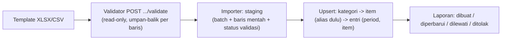

# SPEC: Kebutuhan Sekunder (skema kanonik + template + form)

## Ringkasan
Modul ini mencatat **kebutuhan sekunder / barang tahan lama (durable goods)** untuk BBH —
bukan hanya alat elektronik, tetapi juga **peralatan** dan **mainan** (mis. Sepeda BMX Anak).
Tujuan bukan sekadar "menampilkan list", tetapi **sistem yang mengelola data itu**:
skema tabel kanonik → input lewat **form** dan/atau **template Excel** → data mentah yang kotor
dapat **diperbaiki bertahap** tanpa migrasi ulang.

Modul diwujudkan sebagai **plugin baru** (aturan user: fitur baru = plugin, `internal/` hanya framework):

| Plugin | Topic | Peran |
|---|---|---|
| **`plugins/hsh`** | `1793265053300` | Kebutuhan rumah tangga (habis pakai/pokok) |
| **`plugins/sec`** | `1793265053246` (dokumen ini) | Kebutuhan sekunder (tahan lama: elektronik, peralatan, mainan) |

Kedua plugin **identik bentuk**, dibedakan **prefix** id/plugin/tabel. Dokumen ini = desain
kanonik modul sekunder; SPEC rumah tangga memakai bentuk yang sama.

## Kondisi Awal (terverifikasi 2026-10-29)
- Aset: `List Kebutuhan Elektronik BBH - Updated 22 SEPT 26 2026.xlsx` (5.173.857 byte,
  tercatat di `_meta.yaml.assets`).
- **XLSX asli** (bukan `.xls` BIFF8) → `excelize` dapat membaca langsung. Ukuran besar karena
  **19 gambar produk** tertanam (`xl/media/*`).
- 1 sheet `Sheet1`, dimensi `B2:F316`, 17 merge cell, **tanpa legend warna** (berbeda dari berkas RT).
- Header baris 3: `B=No`, `C=item`, `D=Merk/brand - Type`, `E=Spesifikasi/Specification`
  (multi-baris, satu atribut per baris sel), `F=Harga/Price` (numerik Rupiah). Baris 2 = judul board
  (merge `B2:F2`).
- **18 item**, semuanya berharga. Nama item sebagian menyelipkan merk/varian di kolom C
  (D kosong) atau sebaliknya.
- **Warna kolom C tidak punya legend** (15× magenta `FF00FF`, 1× navy `FF002060` item 12,
  1× `FF66FF` item 17) → **tidak ditafsirkan** sebagai status.
- **Tidak ada** kolom jumlah, satuan, tanggal, maupun cabang.
- Pola acuan yang dipakai ulang: `plugins/resident` / `plugins/hsh` — `schema/fields.yaml` sebagai
  *single source of truth* (→ migrasi, generator template, validator, importer).

## Ruang Lingkup
- Skema kanonik + migrasi + seed kategori.
- Katalog item yang **bisa dikurasi** (kategori, merk, spesifikasi, alias/normalisasi nama, unit, harga).
- Snapshot kondisi per **periode** (riwayat), bukan overwrite.
- Template Excel/CSV **digenerate** + validator umpan-balik + importer.
- Form input di admin panel.
- Permission + swagger + koleksi API.

## Non-Goals
- Alur pengadaan/approval (diajukan → disetujui → dibeli → diterima) dan integrasi keuangan.
- Sinkronisasi data antar instance/yayasan (federasi lintas yayasan).
- Penyimpanan/ekstraksi **gambar produk** (S-15) — di luar ruang lingkup.
- Konversi `.xls` legacy otomatis di dalam sistem.
- Notifikasi/reminder pembelian.

## Keputusan Desain
| # | Keputusan | Nilai |
|---|---|---|
| **S-1** | Nama & prefix | Modul **"Kebutuhan Sekunder"**; plugin **`plugins/sec`**; tabel `sec_*`; permission `sec.*`; endpoint `/admin/sec/...` + template `/admin/sec-template`. |
| **S-2** | Dimensi cabang | **Tidak ada.** Pusat & cabang = aplikasi sama; pembedanya yayasan/instance. Batas data = `INSTANCE_KEY`. Template **tanpa** kolom Cabang. |
| **S-3** | Periode | **Entitas + riwayat snapshot**. `sec_periods` + `sec_entries`. |
| **S-4** | Kategori | **Tabel** `sec_categories` (bukan enum) → bisa tambah/normalisasi tanpa deploy. |
| **S-5** | Nama item | **Disimpan apa adanya**; normalisasi & dedup lewat tabel **alias** `sec_item_aliases`. |
| **S-6** | Atribut | Lengkap & **aditif**: `brand`, `specification`, `unit`, `est_price`, `note` (item); `status_code`, `quantity`, `unit_price`, `note` (entri). |
| **S-7** | Harga | Di **item** (`est_price`, harga satuan referensi) + **override opsional per entri** (`unit_price`). |
| **S-8** | Status | Enum **statis** `URGENT`\|`ENOUGH`\|`UNKNOWN` + `CHECK`. Berkas ini tanpa legend → **semua entri awal `UNKNOWN`**. |
| **S-9** | Permission | `sec.read/write/delete` **di-seed lewat migrasi plugin `auth`** (kalau lupa → semua route 403 fail-closed). |
| **S-10** | ID | `TEXT` berisi **UUID v7** dibuat di Go (`model.NewID`), tanpa `DEFAULT` DB. |
| **S-11** | Template | **Digenerate** dari `schema/fields.yaml`, tidak di-maintain manual. |
| **S-12** | Importer | **2 fasa**: staging → upsert. Kunci idempotensi `(period_code, item match)`. |
| **S-13** | Item nyasar | Item di luar kategori inti (mis. **Sepeda BMX Anak**) tetap masuk, diletakkan di kategori **Mainan & Rekreasi** — bukan dibuang. |
| **S-14** | Alur pemenuhan | **Belum perlu.** Cukup mencatat kebutuhan + status stok. Alur pengadaan = topik terpisah bila kelak dibutuhkan. |
| **S-15** | Gambar produk | **Diabaikan** (19 media tertanam tidak diekstrak/diimpor). |
| **S-16** | Satuan | Daftar **REFERENSI** (dropdown terbatas), statis di `fields.yaml` (tidak ada di data mentah). |
| **S-17** | Dropdown template | Kolom `Kategori`, `Satuan`, `Status` memakai **Excel data validation** dari sheet `REFERENSI` (pola `hsh`/`resident`: `REFERENSI!$X$2:$X$n`). |
| **S-18** | Format berkas impor | Kontrak = **`.xlsx` / `.csv`**. `.xls` (BIFF8) **ditolak** dengan pesan pra-konversi (image runtime tetap Go-only). |
| **S-19** | Auto-create saat impor | Item/kategori baru dibuat otomatis; nama asli dicatat sebagai **alias** (mengikuti keputusan `hsh` N-16). |

## Skema Kanonik

Semua tabel: `id TEXT PK`, `created_at`, `updated_at` (`timestamptz`). Nama field **Bahasa Inggris**
(pola D-7), header template **Bahasa Indonesia**.

### `sec_categories`
| Kolom | Tipe | Catatan |
|---|---|---|
| id | text | PK (UUIDv7) |
| code | text | UNIQUE, slug stabil (mis. `elektronik-peralatan`) |
| name | text | NOT NULL, label tampil (mis. `Elektronik & Peralatan`) |
| sort_order | int | urutan tampil |
| is_active | boolean | NOT NULL DEFAULT true |

### `sec_items` (master katalog)
| Kolom | Tipe | Catatan |
|---|---|---|
| id | text | PK |
| category_id | text | FK → `sec_categories.id` |
| name | text | NOT NULL, **apa adanya** |
| brand | text | opsional, merk/tipe (dari kolom D) |
| specification | text | opsional, teks multi-baris (dari kolom E) |
| unit | text | opsional (mis. `pcs`, `unit`) |
| est_price | numeric(14,2) | harga satuan referensi |
| is_active | boolean | NOT NULL DEFAULT true |
| note | text | opsional |

Index: `UNIQUE (category_id, lower(name))` — cegah duplikat persis; beda penulisan ditangani alias.

### `sec_item_aliases`
| Kolom | Tipe | Catatan |
|---|---|---|
| id | text | PK |
| item_id | text | FK → `sec_items.id` |
| alias | text | NOT NULL, **UNIQUE (lower(alias))** global → 1 alias = 1 item |

Fungsi: menyerap varian kotor dari data mentah (mis. `AC - Air Conditioner` → item kanonik,
`SEPEDA BMX ANAK ...` → item kanonik). Saat impor, alias dicocokkan lebih dulu sebelum `name` persis.

### `sec_periods`
| Kolom | Tipe | Catatan |
|---|---|---|
| id | text | PK |
| code | text | UNIQUE, mis. `2026-09` (dari nama berkas "Updated 22 SEPT 26") |
| label | text | mis. `September 2026` |
| started_on / ended_on | date | opsional |
| is_active | boolean | NOT NULL DEFAULT true; ≤1 periode aktif (aturan aplikasi) |

### `sec_entries` (kondisi per periode)
| Kolom | Tipe | Catatan |
|---|---|---|
| id | text | PK |
| period_id | text | FK → `sec_periods.id` |
| item_id | text | FK → `sec_items.id` |
| status_code | text | NOT NULL, enum `URGENT`\|`ENOUGH`\|`UNKNOWN` + `CHECK` |
| quantity | numeric(12,2) | opsional (tidak ada di data mentah) |
| unit_price | numeric(14,2) | opsional; mengalahkan `items.est_price` bila diisi |
| note | text | opsional |
| recorded_by | text | UUID admin (tanpa FK lintas-plugin) |

Index: `UNIQUE (period_id, item_id)`.

### Enum statis (S-8)
| code | Label (i18n) | Catatan |
|---|---|---|
| `URGENT` | Urgent / Perlu segera | tidak dipakai di seed awal (tanpa legend) |
| `ENOUGH` | Stok cukup | tidak dipakai di seed awal |
| `UNKNOWN` | Tidak diketahui | **default entri hasil impor** |

## Seed Awal (dari berkas "Updated 22 SEPT 26") — **DITUNDA**
> Mengikuti keputusan `hsh` ("bikin sistem dulu aja"). Bagian ini = **rencana**, dieksekusi
> setelah skema/master/template/importer siap.
- **2 kategori**: `elektronik-peralatan` (Elektronik & Peralatan), `mainan-rekreasi` (Mainan & Rekreasi).
- **1 periode**: `2026-09` (nama berkas "Updated 22 SEPT 26").
- **18 item + entri** (status awal `UNKNOWN`), semua dengan `est_price` terisi:
  AC Midea 1PK & 1/2PK, Mesin Cuci Samsung 12kg, Dispenser Sanken, Water Heater Ariston,
  Air Purifier Xiaomi, CCTV EZVIZ, Exhaust Fan Plafon/Dinding/Fresh Air, Dehumidifier Notale,
  Dish Dryer NORGE, Cooker Hood Rinnai, Setrika Philips, Wall Power Fan Maspion, Smart TV Samsung 55",
  Dryer Gas Foggia, **Sepeda BMX Anak (→ `mainan-rekreasi`)**.
- Normalisasi awal yang **wajib** saat seed: pisahkan merk/varian dari nama item (item 11, 12),
  lengkapi `brand` untuk item yang kosong (item 8, 18), catat varian lama sebagai alias.

## Kontrak Template Excel/CSV (digenerate, S-11)
Sheet: **PETUNJUK** · **DATA** · **REFERENSI** · **CONTOH**.
Kolom sheet DATA (header Bahasa Indonesia):

| Kolom | Field | Wajib | Kendali |
|---|---|---|---|
| Periode | `periods.code` (`YYYY-MM`) | ya | teks bebas (format divalidasi) |
| Kategori | `categories.code` | ya | **dropdown** REFERENSI |
| Nama Kebutuhan | `items.name` | ya | teks bebas (auto-create item + alias, S-19) |
| Merk/Brand | `items.brand` | tidak | teks |
| Spesifikasi | `items.specification` | tidak | teks (multi-baris) |
| Satuan | `items.unit` | tidak | **dropdown** REFERENSI |
| Harga Satuan | `items.est_price` | tidak | angka |
| Status | `entries.status_code` | tidak | **dropdown** REFERENSI |
| Jumlah | `entries.quantity` | tidak | angka |
| Catatan | `entries.note` | tidak | teks |

**Dropdown (S-17)**: kolom bertanda dropdown memakai Excel *data validation* berisi rumus ke sheet
`REFERENSI`. Label dropdown **Bahasa Indonesia**; validator memetakan balik ke `code`.

`REFERENSI` memuat: kategori (semua), satuan, dan status. Versi template ditulis di `PETUNJUK`
(`template_version`) supaya validator bisa menolak berkas versi usang.

## Alur Impor

- Fasa staging menyimpan **laporan** agar impor bisa diaudit dan diulang (idempoten).
- **Auto-create (S-19)**: item baru dibuat otomatis; nama asli baris ter-catat sebagai **alias**.
- Item dicocokkan berurutan: **alias** → **name persis (case/space-insensitive)** → **buat item baru**.
- Format: `.xlsx` / `.csv` saja; `.xls` → tolak dengan pesan pra-konversi (S-18).
- Validasi **tidak menulis** DB (`POST .../validate` read-only).

## API & Permission
Guard: `middleware.RequirePermission(authSvc, "sec.<verb>")` — read/write/delete.
Grup `api` sudah ber-prefix `/api`, jadi path relatif:

| Method | Path | Guard |
|---|---|---|
| GET/POST | `/admin/sec/categories` | read / write |
| PATCH/DELETE | `/admin/sec/categories/:id` | write / delete |
| GET/POST | `/admin/sec/items` | read / write |
| GET/PUT/PATCH/DELETE | `/admin/sec/items/:id` | read / write / write / delete |
| GET/POST | `/admin/sec/items/:id/aliases` | read / write |
| DELETE | `/admin/sec/items/:id/aliases/:aliasId` | write |
| GET/POST | `/admin/sec/periods` | read / write |
| PATCH/DELETE | `/admin/sec/periods/:id` | write / delete |
| GET/POST | `/admin/sec/entries` | read / write |
| PATCH/DELETE | `/admin/sec/entries/:id` | write / delete |
| GET | `/admin/sec/entries/summary?period_id=` | read |
| GET | `/admin/sec-template?format=xlsx\|csv` | read |
| POST | `/admin/sec-template/validate` | read |
| POST | `/admin/sec-template/import` | write |

Path template dibuat **flat** agar tidak bentrok wildcard `/:id` (pola `hsh`/`resident`).

## UI (admin panel)
- `Kategori` — CRUD ringan (code, name, sort_order, is_active).
- `Item` — list + filter kategori + search, form item (nama, kategori, merk, spesifikasi, satuan,
  harga, aktif, catatan), pengelolaan **alias**.
- `Periode` — CRUD periode + aksi "jadikan aktif".
- `Entri` — **tampilan matriks** per periode: baris = item, kolom = status/jumlah/catatan,
  aksi massal ubah status (mencerminkan cara kerja berkas asli).
- Tombol **Unduh Template** + **Impor** (unggah berkas → tampil laporan validasi).
- Menu ditempatkan pada grup navigasi **"Kebutuhan"** (paralel `hsh`).

## Gap & Risiko
| GAP | Deskripsi | Rencana |
|---|---|---|
| GAP-1 | Warna kolom C tanpa legend | Tidak ditafsirkan (S-8); status awal `UNKNOWN`. |
| GAP-2 | Nama item kotor (merk menyatu) | Tabel alias + seed ternormalisasi. |
| GAP-3 | Jumlah/satuan kosong di data mentah | Kolom nullable; diisi bertahap via form/template. |
| GAP-4 | Belum ada UI form | WO UI. |
| GAP-5 | Permission belum di-seed di plugin `auth` | WO seed permission (fail-closed). |
| GAP-6 | Gambar produk tertanam | Diabaikan (S-15). |
| GAP-7 | Item nyasar (Sepeda BMX) | Kategori `mainan-rekreasi` (S-13). |
| GAP-8 | Berkas 5 MB karena 19 gambar | Impor hanya membaca sel (bukan media); aman. |
| GAP-9 | Prefix tabel & permission kembar dgn plugin rumah tangga | Konvensi `sec_*` / `hsh_*`. |

## Pertanyaan Terbuka
- [x] **O-1** ~~Scope penamaan "elektronik"~~ → **DIKUNCI**: modul = **"Kebutuhan Sekunder"** (elektronik, peralatan, mainan).
- [x] **O-2** ~~Prefix plugin~~ → **DIKUNCI**: **`sec`**.
- [x] **O-3** ~~Tanpa dimensi cabang~~ → **DIKUNCI**: ya (S-2).
- [x] **O-4** ~~Item nyasar (Sepeda BMX)~~ → **DIKUNCI**: masuk kategori Mainan & Rekreasi (S-13, S-4).
- [x] **O-5** ~~Status stok~~ → **DIKUNCI**: tanpa legend bermakna → default `UNKNOWN` (S-8).
- [x] **O-6** ~~Alur pemenuhan~~ → **DIKUNCI**: belum perlu (S-14).
- [ ] **O-7** ~~Kategori final~~ → awal 2 kategori (`elektronik-peralatan`, `mainan-rekreasi`) — dapat ditambah saat review.
- [ ] **O-8** Periode di template (kolom vs parameter) — usulan: **kolom `Periode`** di sheet DATA (konsisten `hsh`).

**Status dokumen:** `complete` — desain final & terimplementasi (WO-01..06, 08, 09 selesai);
hanya **WO-07 (seed data awal) yang ditunda** menunggu data owner.

**Catatan lintas topik:** plugin `hsh` (topic `1793265053300`) adalah **kembar struktur** modul ini;
perbedaannya hanya isi kategori & data. Batas domain: `hsh` = habis pakai/pokok, `sec` = tahan lama.

## Rencana Work Order (draft)
| WO | Judul | Isi |
|---|---|---|
| WO-01 | Skeleton plugin + skema | `plugins/sec`, `schema/fields.yaml`, migrasi 5 tabel + enum + seed kategori |
| WO-02 | Permission + CRUD kategori/item/alias | Seed `sec.*` di migrasi `auth`; API + service + test |
| WO-03 | Periode & entri API | CRUD periode + entri + query/ringkasan per periode |
| WO-04 | Generator template | `GET /admin/sec-template?format=xlsx\|csv` dari `fields.yaml` |
| WO-05 | Validator umpan-balik | `POST .../sec-template/validate` (read-only, error per baris + header ringkasan) |
| WO-06 | Importer | Staging → upsert, alias-first matching, laporan; pra-konversi `.xls` |
| WO-07 | Seed data awal **_(ditunda)_** | Impor berkas "Updated 22 SEPT 26" + laporan normalisasi (GAP-2/7) |
| WO-08 | UI admin panel | Kategori, Item (+alias), Periode, Entri (matriks), Unduh/Impor |
| WO-09 | Swagger + README + Bruno | Paritas dokumentasi & koleksi API |
