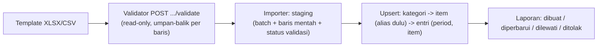

# SPEC: Kebutuhan Rumah Tangga (skema kanonik + template + form)

## Ringkasan
Tujuan bukan sekadar "menampilkan list kebutuhan", tetapi **sistem yang mengelola data itu**:
skema tabel kanonik → input lewat **form** dan/atau **template Excel** → raw data yang kotor
(`.xls` bilingual, status berupa warna sel) dapat **diperbaiki bertahap** tanpa migrasi ulang.

Modul diwujudkan sebagai **plugin baru** (aturan user: fitur baru = plugin, `internal/` hanya framework):

| Plugin | Topic | Peran |
|---|---|---|
| **`plugins/hsh`** | `1793265053300` (dokumen ini) | Kebutuhan rumah tangga |
| **`plugins/sec`** | `1793265053246` | Kebutuhan sekunder — tahan lama: elektronik, peralatan, mainan (kembar) |

Kedua plugin **identik bentuk**, dibedakan **prefix** id/plugin/tabel. Dokumen ini = **desain
kanonik**; SPEC topik sekunder menyalin bentuk yang sama (hanya isi kategori & datanya berbeda).

## Kondisi Awal (terverifikasi)
- Aset: `List Kebutuhan RT  BBH  SEPT 19 OKT 26 d.xls` (35.840 byte, tercatat di `_meta.yaml.assets`).
- **XLS legacy (OLE2/BIFF8)** — 1 sheet, dimensi `B1:L54`, data aktual hanya kolom **B–E**, 10 merge cell.
  `excelize` (dipakai plugin `resident`) **tidak** dapat membaca BIFF → perlu konversi (GAP-1).
- Bentuk data: **kolom-kolom daftar**, bukan tabel baris-per-item. Judul board
  `Kebutuhan Bali Baby Home/Bali Baby Home Needs` muncul **2×** (r2 & r33) → **2 blok snapshot**.
- **Status dikodekan lewat warna sel**, legendanya ada di dalam berkas (r25–27 & r51–53):
  pink `FFFF99CC` = *Urgent / No stock — Out of Stock*; navy `FF003366` = *Enough Stock*;
  kuning `FFFFFF00` = header kategori; abu `FFC0C0C0` = judul board; putih = tidak ditandai.
- 7 kategori, ±118 item. **Tidak ada** kolom jumlah, satuan, harga, tanggal, maupun cabang.
- Pola acuan yang dipakai ulang: `plugins/resident` — `schema/fields.yaml` sebagai
  *single source of truth* (→ migrasi, generator template WO-08, validator WO-09, importer WO-06).

## Ruang Lingkup
- Skema kanonik + migrasi + seed kategori/periode.
- Katalog item yang **bisa dikurasi** (kategori, alias/normalisasi nama, unit, harga referensi).
- Snapshot kondisi per **periode** (riwayat), bukan overwrite.
- Template Excel/CSV **digenerate** + validator umpan-balik + importer.
- Form input di admin panel.
- Permission + swagger + koleksi API.

## Non-Goals
- Alur pengadaan/approval (diajukan → disetujui → dibeli → diterima) dan integrasi keuangan.
- Sinkronisasi data antar instance/yayasan (federasi lintas yayasan).
- Konversi `.xls` legacy otomatis di dalam sistem (kecuali O-6 diputuskan lain).
- Notifikasi/reminder stok.

## Keputusan Desain
| # | Keputusan | Nilai |
|---|---|---|
| **N-1** | Dimensi cabang | **Tidak ada.** Pusat & cabang = aplikasi yang sama; pembedanya **yayasan/instance**. Batas data = `INSTANCE_KEY`. Template **tanpa** kolom Cabang. |
| **N-2** | Periode | **Entitas + riwayat snapshot**. `*_periods` + `*_entries` (append per periode). |
| **N-3** | Kategori | **Tabel** `*_categories` (bukan enum statis) → bisa tambah/normalisasi tanpa deploy. |
| **N-4** | Nama item | **Disimpan apa adanya** (bilingual gabung, seperti di berkas). Normalisasi & dedup lewat tabel **alias**. |
| **N-5** | Atribut | Lengkap & **aditif**: satuan, harga, jumlah, catatan. Kolom baru = migrasi baru. |
| **N-6** | Struktur plugin | **Dua plugin terpisah** (`hsh`, `sec`). Satu DB → **prefix tabel wajib** (`hsh_*`, `sec_*`). |
| **N-7** | Harga | Di **item** (`est_price`, harga satuan referensi) + **override opsional per entri** (`unit_price`). |
| **N-8** | Status | Enum **statis** di kode + `CHECK`: `URGENT`, `ENOUGH`, `UNKNOWN` (label Indonesia via i18n). |
| **N-9** | Permission | `hsh.read/write/delete` **di-seed lewat migrasi plugin `auth`** (pola `resident`; kalau lupa → semua route 403 fail-closed). |
| **N-10** | ID | `TEXT` berisi **UUID v7** dibuat di Go (`model.NewID`), tanpa `DEFAULT` DB. |
| **N-11** | Template | **Digenerate** dari `schema/fields.yaml`, tidak di-maintain manual. |
| **N-12** | Importer | **2 fasa**: staging → upsert. Kunci idempotensi `(period_code, item match)`. |
| **N-13** | Satuan | Daftar **REFERENSI** (dropdown terbatas). Disimpan sebagai daftar **statis di `fields.yaml`**; dipromosikan ke tabel bila kelak perlu dikelola lewat UI. |
| **N-14** | Dropdown template | Kolom `Kategori`, `Satuan`, `Status` memakai **Excel data validation** dari sheet `REFERENSI` (pola `resident`: `REFERENSI!$X$2:$X$n`). `Periode` = kolom bebas format `YYYY-MM`. |
| **N-15** | Seed data awal | **Ditunda** ("bikin sistem dulu", 2026-10-29). Skema, master, template, importer dibangun lebih dulu. |
| **N-16** | Auto-create saat impor | **Ya** (O-2 = B): item baru dibuat otomatis + nama aslinya dicatat sebagai **alias**. Kategori tetap dari dropdown. |
| **N-17** | Format berkas impor | Kontrak resmi = **`.xlsx` / `.csv`** (dibaca `excelize`). **`.xls` (BIFF8) ditolak** dengan pesan jelas + instruksi pra-konversi; konversi server-side tidak dilakukan (image runtime tetap Go-only). |
| **N-18** | Alur pemenuhan | **Belum perlu.** Cukup mencatat kebutuhan + status stok (`URGENT`/`ENOUGH`/`UNKNOWN`). Alur pengadaan = topik terpisah bila kelak dibutuhkan. |

## Skema Kanonik

Semua tabel: `id TEXT PK`, `created_at`, `updated_at` (`timestamptz`). Nama field **Bahasa Inggris**
(pola D-7), header template **Bahasa Indonesia**.

### `hsh_categories`
| Kolom | Tipe | Catatan |
|---|---|---|
| id | text | PK (UUIDv7) |
| code | text | UNIQUE, slug stabil (mis. `housekeeping`) |
| name | text | NOT NULL, label tampil (mis. `Housekeeping & Equipment / Rumah Tangga & Peralatan`) |
| sort_order | int | urutan tampil |
| is_active | boolean | NOT NULL DEFAULT true |

### `hsh_items` (master katalog)
| Kolom | Tipe | Catatan |
|---|---|---|
| id | text | PK |
| category_id | text | FK → `*_categories.id` |
| name | text | NOT NULL, **apa adanya** (boleh bilingual gabung) |
| unit | text | opsional (mis. `pcs`, `botol`) |
| est_price | numeric(14,2) | harga satuan referensi (N-7) |
| is_active | boolean | NOT NULL DEFAULT true |
| note | text | opsional |

Index: `UNIQUE (category_id, lower(name))` — cegah duplikat persis; beda penulisan ditangani alias.

### `hsh_item_aliases`
| Kolom | Tipe | Catatan |
|---|---|---|
| id | text | PK |
| item_id | text | FK → `*_items.id` |
| alias | text | NOT NULL, **UNIQUE (lower(alias))** global → 1 alias = 1 item |

Fungsi: menyerap varian kotor dari data mentah (mis. `PARATUSIN TAB` → item `Paratusin Tablet`,
`Sepidol Warna` → item kanonik, `Telon oil/Minyak telon` → nama ternormalisasi). Saat impor,
alias dicocokkan lebih dulu sebelum `name` persis.

### `hsh_periods`
| Kolom | Tipe | Catatan |
|---|---|---|
| id | text | PK |
| code | text | UNIQUE, mis. `2026-09`, `2026-10-19` (dari 2 blok berkas) |
| label | text | mis. `September 2026` |
| started_on / ended_on | date | opsional |
| is_active | boolean | NOT NULL DEFAULT true; ≤1 periode aktif (aturan aplikasi) |

### `hsh_entries` (kondisi per periode)
| Kolom | Tipe | Catatan |
|---|---|---|
| id | text | PK |
| period_id | text | FK → `*_periods.id` |
| item_id | text | FK → `*_items.id` |
| status_code | text | NOT NULL, enum `URGENT`\|`ENOUGH`\|`UNKNOWN` + `CHECK` |
| quantity | numeric(12,2) | opsional (tidak ada di data mentah) |
| unit_price | numeric(14,2) | opsional; mengalahkan `items.est_price` bila diisi |
| note | text | opsional |
| recorded_by | text | UUID admin (tanpa FK lintas-plugin) |

Index: `UNIQUE (period_id, item_id)`.

### Enum statis (N-8)
| code | Label (i18n) | Asal berkas |
|---|---|---|
| `URGENT` | Urgent / Stok kosong | fill pink `FFFF99CC` |
| `ENOUGH` | Stok cukup | fill navy `FF003366` |
| `UNKNOWN` | Tidak diketahui | tanpa fill / putih |

## Seed Awal (dari berkas SEPT–OKT) — **DITUNDA (N-15)**

> Keputusan owner 2026-10-29: *"kita bikin sistem dulu aja"*. Bagian ini tetap disimpan sebagai
> **rencana**, dieksekusi setelah skema/master/template/importer siap (WO-07, statusnya ditunda).
- **7 kategori** (dinormalkan; typo diperbaiki di data, bukan di kode):
  `baby_needs` (Baby Needs/Kebutuhan Bayi & Diaper), `milk`, `food`, `stationery`
  (Stationery & Educational Tools), `medicine` (Medicine & Vitamin),
  `housekeeping` (**Housekeeping & Equipment** — perbaikan dari `Equpment`), `linen`.
- **2 periode**: `2026-09` (blok r2–32) dan `2026-10-19` (blok r33–54).
- **±118 item + entri** dengan status: total urgen ≈ 81, enough ≈ 5, sisanya `UNKNOWN`.
  Sebaran per kategori (blok 1/2 digabung): Baby Needs 34 · Milk 10 · Food 13 · Stationery 4 ·
  Medicine 31 · Housekeeping 18 · Linen 8.
- Normalisasi awal yang **wajib** dilakukan saat seed (GAP-2/GAP-7/GAP-8):
  nama bilingual tanpa separator (`Zaitun oil for Baby's bodyMinyak zaitun…`), urutan terbalik
  (`Telon oil/Minyak telon`), spasi ekor, item nyasar antar kategori
  (`Hanging Air Freshener` di blok Stationery; `Meja kursi ceria` di kolom Food),
  dan duplikat makna obat (`PARATUSIN TAB` vs `Paratusin Tablet`).

## Kontrak Template Excel/CSV (digenerate, N-11)
Sheet: **PETUNJUK** · **DATA** · **REFERENSI** · **CONTOH**.
Kolom sheet DATA (header Bahasa Indonesia):

| Kolom | Field | Wajib | Kendali |
|---|---|---|---|
| Periode | `periods.code` (`YYYY-MM`) | ya | teks bebas (format divalidasi) |
| Kategori | `categories.code` | ya | **dropdown** REFERENSI |
| Nama Kebutuhan | `items.name` | ya | dropdown master **atau** teks bebas — **O-2, menunggu keputusan** |
| Satuan | `items.unit` | tidak | **dropdown** REFERENSI |
| Harga Satuan | `items.est_price` | tidak | angka |
| Status | `entries.status_code` | ya | **dropdown** REFERENSI |
| Jumlah | `entries.quantity` | tidak | angka |
| Catatan | `entries.note` | tidak | teks |

**Dropdown (N-14)**: kolom bertanda dropdown memakai Excel *data validation* berisi rumus ke sheet
`REFERENSI` (pola yang sudah dipakai plugin `resident` untuk 6 kolom enum). Label dropdown memakai
**Bahasa Indonesia**; validator memetakan balik ke `code`.

**Catatan praktis dropdown Nama Kebutuhan**: bila dijadikan dropdown dari master, daftar bisa
ratusan baris dan berkas yang sudah terunduh **tidak ikut ter-update** saat master berubah —
operator harus **unduh ulang** template. Karena itu pilihan A (dropdown/fail-closed) vs B (teks bebas
dengan auto-create) perlu keputusan O-2.

`REFERENSI` memuat: kategori (semua 7 kategori), satuan, dan status. Versi template ditulis di
`PETUNJUK` (`template_version`) supaya validator bisa menolak berkas versi usang.

## Alur Impor

- Fasa staging menyimpan **laporan** agar impor bisa diaudit dan diulang (idempoten).
- **Auto-create (N-16 / O-2 = B)**: item baru dibuat otomatis; nama asli baris itu otomatis tercatat sebagai **alias**. Kategori hanya boleh dari daftar REFERENSI (bukan auto-create).
- Item dicocokkan dengan urutan: **alias** → **name persis (case/space-insensitive)** → **buat item baru**.
- Format: `.xlsx` / `.csv` saja; `.xls` → tolak dengan pesan pra-konversi (N-17).
- Tidak menulis DB pada tahap validasi (`POST .../validate` read-only).

## API & Permission
Guard: `middleware.RequirePermission(authSvc, "hsh.<verb>")` — read/write/delete.
Grup `api` sudah ber-prefix `/api`, jadi path relatif:

| Method | Path | Guard |
|---|---|---|
| GET/POST | `/admin/hsh/categories` | read / write |
| PATCH/DELETE | `/admin/hsh/categories/:id` | write / delete |
| GET/POST | `/admin/hsh/items` | read / write |
| GET/PUT/PATCH/DELETE | `/admin/hsh/items/:id` | read / write / write / delete |
| GET/POST | `/admin/hsh/items/:id/aliases` | read / write |
| DELETE | `/admin/hsh/items/:id/aliases/:aliasId` | write |
| GET/POST | `/admin/hsh/periods` | read / write |
| PATCH/DELETE | `/admin/hsh/periods/:id` | write / delete |
| GET/POST | `/admin/hsh/entries` | read / write |
| PATCH/DELETE | `/admin/hsh/entries/:id` | write / delete |
| GET | `/admin/hsh-template?format=xlsx\|csv` | read |
| POST | `/admin/hsh-template/validate` | read |
| POST | `/admin/hsh-template/import` | write |

Path template dibuat **flat** agar tidak bentrok wildcard `/:id` (pola WO-08 `resident`).

## UI (admin panel)
- `Kategori` — CRUD ringan (code, name, sort_order, is_active).
- `Item` — list + filter kategori + search, form item (nama, kategori, satuan, harga, aktif, catatan),
  pengelolaan **alias**.
- `Periode` — CRUD periode + aksi "jadikan aktif".
- `Entri` — **tampilan matriks** per periode: baris = item, kolom = status/jumlah/catatan,
  aksi massal ubah status (mencerminkan cara kerja berkas asli).
- Tombol **Unduh Template** + **Impor** (unggah berkas → tampil laporan validasi).

## Gap & Risiko
| GAP | Deskripsi | Rencana |
|---|---|---|
| GAP-1 | `.xls` legacy BIFF8 tak terbaca `excelize` | Kontrak impor `.xlsx`/`.csv`; `.xls` ditolak dengan pesan pra-konversi (N-17). Konversi manual tersedia di host (`soffice`) untuk kebutuhan seed. |
| GAP-2 | Nama item kotor/bilingual gabung | Tabel alias + seed ternormalisasi |
| GAP-3 | Harga & jumlah kosong di data mentah | Kolom nullable; diisi bertahap via form/template |
| GAP-4 | Belum ada UI form | WO UI |
| GAP-5 | Permission belum di-seed di plugin `auth` | WO seed permission (fail-closed) |
| GAP-6 | Tidak ada padanan EN terpisah (N-4) | Diterima; EN bisa masuk ke `name` |
| GAP-7 | Item nyasar antar kategori di berkas | Koreksi saat seed; dicatat di laporan |
| GAP-8 | Duplikat nama beda penulisan | Alias + dedup saat seed |
| GAP-9 | Prefix tabel & permission kembar dgn plugin sekunder | Konvensi `hsh_*` / `sec_*` |

## Pertanyaan Terbuka
- [x] **O-1** ~~Periode di template~~ → **DIKUNCI**: **kolom `Periode` di sheet DATA** (bebas per baris, format `YYYY-MM`).
- [x] **O-2** ~~Cakupan dropdown Nama Kebutuhan~~ → **DIKUNCI**: **(B) teks bebas + auto-create item & alias** (N-16).
- [x] **O-3** ~~Satuan~~ → **DIKUNCI**: **daftar REFERENSI** (dropdown terbatas), dikelola sebagai daftar statis di `fields.yaml` (N-13).
- [x] **O-4** ~~Alur pemenuhan~~ → **DIKUNCI**: **belum perlu** (N-18).
- [x] **O-5** ~~Scope kategori~~ → **DIKUNCI**: **semua 7 kategori** masuk (baby needs, milk, food, stationery, medicine, housekeeping, linen).
- [x] **O-6** ~~Format berkas~~ → **DIKUNCI**: `.xlsx`/`.csv` sebagai kontrak; `.xls` ditolak + instruksi pra-konversi (N-17).
- [x] **O-7** ~~Data awal~~ → **DIKUNCI**: *"bikin sistem dulu"* → seed data awal **ditunda** (N-15).

**Konfirmasi struktur dokumen** (2026-10-29): SPEC ditulis **paralel di masing-masing topic**,
dibedakan prefix plugin/tabel — **bukan** memakai topic induk.

**Status dokumen:** `draft` — **menunggu review owner** sebelum `work-order.md` disusun.

**Catatan lintas topik:** topic `sec` (`1793265053246`) semula bernama "Kebutuhan Elektronik",
kini **"Kebutuhan Sekunder"** (barang tahan lama: elektronik, peralatan, mainan). Data mentah sudah
ada (2026-10-29); SPEC topik itu menyalin bentuk dokumen ini.

## Rencana Work Order (draft)
| WO | Judul | Isi |
|---|---|---|
| WO-01 | Skeleton plugin + skema | `plugins/hsh`, `schema/fields.yaml`, migrasi 5 tabel + enum + seed kategori/periode |
| WO-02 | Permission + CRUD kategori/item/alias | Seed `hsh.*` di migrasi `auth`; API + service + test |
| WO-03 | Periode & entri API | CRUD periode + entri + query per periode (ringkasan urgen) |
| WO-04 | Generator template | `GET /admin/hsh-template?format=xlsx\|csv` dari `fields.yaml` |
| WO-05 | Validator umpan-balik | `POST .../template/validate` (read-only, error per baris + header ringkasan) |
| WO-06 | Importer | Staging → upsert, alias-first matching, laporan; pra-konversi `.xls` |
| WO-07 | Seed data awal **_(ditunda, N-15)_** | Impor berkas SEPT–OKT + laporan normalisasi (GAP-2/7/8) |
| WO-08 | UI admin panel | Kategori, Item (+alias), Periode, Entri (matriks), Unduh/Impor |
| WO-09 | Swagger + README + Bruno | Paritas dokumentasi & koleksi API |

**Catatan lintas topik:** plugin `sec` (topic `1793265053246`, "Kebutuhan Sekunder") mengikuti bentuk
yang sama; perbedaannya hanya sumber kategori/item serta batas domain (hsh = habis pakai, sec = tahan lama).
