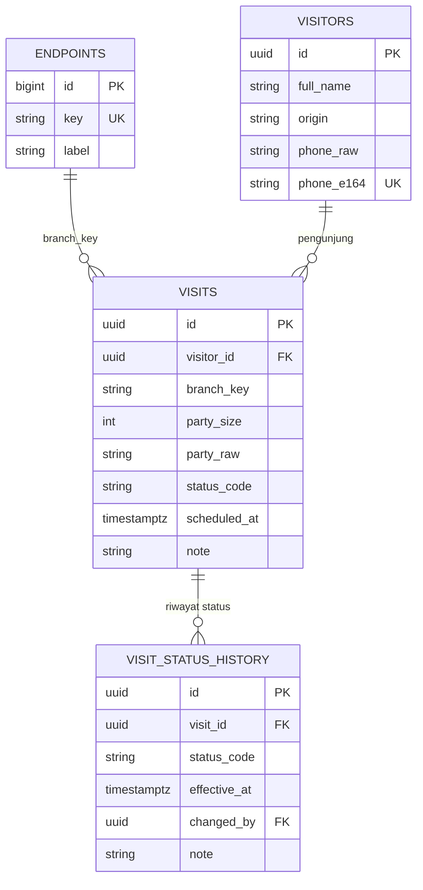

# SPEC: Modul Kunjungan — Skema & Rencana Plugin

## 1. Konteks & Tujuan

**Latar:** BBH menerima permintaan kunjungan (booking) dari calon pengunjung — lokal maupun internasional — yang saat ini dicatat di Notion dan diekspor CSV (`KUNJUNGAN HARI INI ..._all.csv`, 1.639 baris; analisa lengkap di `notes.md` topic ini).

**Tujuan modul:** memindahkan pengelolaan kunjungan ke BBH Data Board: satu skema kanonik, validasi & impor terkontrol, pengelolaan status kunjungan oleh admin, dan siap dipakai dashboard lintas modul.

**Selaras arsitektur existing (aturan yang sudah terkunci di topic lain):**

| # | Aturan | Sumber |
|---|---|---|
| R-1 | Fitur baru wajib plugin `plugins/<id>/`, kode fitur tidak boleh di `internal/` | topic setup sistem |
| R-2 | Skema via migrasi versioned plugin; tidak ada `CREATE TABLE` di kode Go | resident SPEC P-7 |
| R-3 | Identitas cabang = `endpoints.key` / env `INSTANCE_KEY`, tanpa tabel `branches` | resident SPEC P-10 |
| R-4 | Enum nilai kategorikal = statis di kode + `fields.yaml` + CHECK constraint, label via i18n; tanpa tabel `ref_*` | resident D-3 |
| R-5 | Nama kolom Bahasa Inggris; nilai enum istilah domain | resident D-7 |
| R-6 | Permission `<prefix>.read/write/delete` di-seed via migrasi plugin `auth` (fail-closed) | jebakan WO-03 resident |
| R-7 | Template impor digenerate dari `schema/fields.yaml` (satu sumber kebenaran) | resident P-13 |
| R-8 | API admin di `/api/admin/...`, template flat `/api/admin/<prefix>-template`, Bruno di `api-tests/`, UI di `src/pages/admin/...` + nav registry `src/navigation/menu.ts` | pola hsh/sec |
| R-9 | ID = UUIDv7 TEXT | hsh/sec N-10 |

**Ruang lingkup SPEC ini:** desain skema + pemetaan normalisasi + rencana WO. Tidak termasuk implementasi Go/React.

## 2. Temuan Data (ringkas — detail di `notes.md`)

- 1.639 baris = **booking kunjungan**, status sumber hanya `Not started` (1.629) / `Done` (10).
- 17 baris duplikat persis (artefak ekspor) → efektif 1.622 booking unik.
- `Jumlah Pengunjung`: 1.208 angka bersih, sisanya rentang/teks bebas (±330 baris).
- `Nomor HP`: 1.165 lokal, 317 internasional, sisanya format lain/kosong.
- `Waktu Kunjungan`: `DD Month YYYY HH:MM (GMT+8)`, bulan campur ID/EN, rentang Apr–Des 2026; 14 kosong.

## 3. ERD

> **Tiga tabel**, prefix `visit_*` (**D-2 DIKUNCI** owner 2026-11-03: EN, konsisten dgn `resident`/`hsh`/`sec`). Tidak ada tabel `branches` (R-3), tidak ada `ref_*` (R-4).

## 4. Definisi Tabel

### 4.1 `visitors` — master pengunjung (**D-3 DIKUNCI**: dua lapis, owner 2026-11-03)

| Kolom | Tipe | Null | Keterangan |
|---|---|---|---|
| `id` | UUID (v7) | no | PK |
| `full_name` | TEXT | no | trim |
| `origin` | TEXT | yes | Asal — negara/kota/alamat bebas dari kolom `Alamat` |
| `phone_raw` | TEXT | yes | Nomor HP apa adanya (dipertahankan untuk audit) |
| `phone_e164` | TEXT | yes | **UNIQUE bila terisi.** Hasil normalisasi E.164, mis. `+628123...` |
| `note` | TEXT | yes | Catatan (mis. "(WA)") |
| `created_at`/`updated_at` | TIMESTAMPTZ | no | Audit |

**Dedup:** kunci praktis = `phone_e164` (nama terlalu umum). Normalisasi HP:
- `08...` → `+628...`; `821...` (tanpa nol) → `+628...`; `+<kode>...` → rapikan spasi; `06-40961768` → teks asli dipertahankan, E.164 dibiarkan NULL bila tidak yakin.
- Bila dedup gagal (HP beda/NULL), baris impor jadi `visitors` baru — diterima sebagai kelemahan MVP; penggabungan manual menyusul.

### 4.2 `visits` — booking kunjungan

| Kolom | Tipe | Null | Keterangan |
|---|---|---|---|
| `id` | UUID (v7) | no | PK |
| `visitor_id` | UUID | no | FK → `visitors` |
| `branch_key` | TEXT | no | → `endpoints.key`; default env `INSTANCE_KEY` (D-10: per cabang) |
| `party_size` | INT | yes | Hasil parse `Jumlah Pengunjung`; NULL bila tidak terparse |
| `party_raw` | TEXT | yes | Teks asli kolom `Jumlah Pengunjung` (mis. `2-4`, `Just myself`) |
| `status_code` | TEXT | no | enum — lihat §4.4; default `SCHEDULED` |
| `scheduled_at` | TIMESTAMPTZ | yes | `Waktu Kunjungan` dikonversi ke UTC (sumber GMT+8); NULL bila sumber kosong |
| `note` | TEXT | yes | Catatan admin |
| `created_at`/`updated_at` | TIMESTAMPTZ | no | Audit |

**Prinsip:** nilai yang tidak yakin di-parse TIDAK dipaksakan — angka NULL + raw tersimpan. Derived (mis. "dewasa vs anak" dari teks) tidak dibuat kolom tersendiri di MVP.

### 4.3 `visit_status_history` — riwayat status (append-only)

| Kolom | Tipe | Null | Keterangan |
|---|---|---|---|
| `id` | UUID (v7) | no | PK |
| `visit_id` | UUID | no | FK → `visits` |
| `status_code` | TEXT | no | enum §4.4 |
| `effective_at` | TIMESTAMPTZ | no | Waktu status berlaku (default: saat perubahan) |
| `note` | TEXT | yes | Catatan (mis. alasan batal) |
| `changed_by` | UUID | yes | FK → `admins` (audit) |
| `created_at` | TIMESTAMPTZ | no | Waktu pencatatan |

> Status terkini = baris `effective_at` terbesar; pola sama dengan `resident_status_history`. Baris pertama dibuat otomatis saat booking masuk (impor/API) dengan status awal.

### 4.4 Enum statis (**D-5 DIKUNCI**: lengkap 5 nilai, owner 2026-11-03)

| Grup | Nilai baku | Dipetakan dari sumber |
|---|---|---|
| `visit_status` | `SCHEDULED`, `DONE`, `CANCELLED`, `NO_SHOW`, `RESCHEDULED` | `Not started` → `SCHEDULED`; `Done` → `DONE` |

Kolom: `visits.status_code`, `visit_status_history.status_code`. CHECK constraint + konstanta Go + `fields.yaml`.

## 5. Pemetaan Normalisasi (CSV sumber → kanonik)

| Kolom sumber | Field kanonik | Transformasi |
|---|---|---|
| `Nama` | `visitors.full_name` | trim; nama duplikat-persis dilewati (idempotensi impor) |
| `Alamat` | `visitors.origin` | trim; kosong→NULL |
| `Nomor HP` | `visitors.phone_raw` / `phone_e164` | normalisasi §4.1; gagal → NULL, tetap tersimpan raw |
| `Jumlah Pengunjung` | `visits.party_raw` / `party_size` | `^\d+$` → angka; `a-b` → ambil batas bawah (atau NULL, lihat O-6); lainnya → raw saja |
| `Status Kunjungan` | `visits.status_code` + 1 baris history | `Not started`→`SCHEDULED`, `Done`→`DONE`, tak dikenal→`SCHEDULED` + lapor validator |
| `Waktu Kunjungan` | `visits.scheduled_at` | parse bulan ID+EN; `GMT+8` → UTC; kosong → NULL |
| — (identitas ekspor) | — | **Idempotensi impor:** duplikat ekspor dikenali dari `(phone_e164, scheduled_at)` yang sama persis; kemunculan pertama menang, sisanya `skipped` |

## 6. Keputusan (D) — **SEMUA DIKUNCI** (owner 2026-11-03)

| # | Keputusan | Usulan |
|---|---|---|
| D-1 | Bentuk data = booking (permintaan kunjungan), bukan log kehadiran | Ya |
| D-2 | Prefix = `visit` (`plugins/visit`, `visit_*`, `visit.*`, `/api/admin/visit/...`) | **DIKUNCI: `visit` (EN)** |
| D-3 | Dua entitas: `visitors` (master, dedup via phone_e164) + `visits` (booking) | **DIKUNCI: A (dua lapis)** |
| D-4 | Nilai tak terparse disimpan mentah (`party_raw`, `phone_raw`), kanonik boleh NULL | Ya |
| D-5 | Status = enum statis `SCHEDULED/DONE/CANCELLED/NO_SHOW/RESCHEDULED` | **DIKUNCI: 5 nilai** |
| D-6 | Riwayat status append-only + status terkini agregasi | Ya |
| D-7 | Waktu disimpan TIMESTAMPTZ UTC; zona sumber dianggap tetap GMT+8 | Ya |
| D-8 | Idempotensi impor = duplikat ekspor persis di-skip; repeat visitor = baris `visits` baru | Ya |
| D-9 | Template impor digenerate dari `fields.yaml`; kolom sumber dipertahankan sebagai header template agar round-trip Notion→sistem mulus | Ya |
| D-10 | Kunjungan berdimensi cabang (`branch_key` → `endpoints.key`, default env `INSTANCE_KEY`) | **DIKUNCI: per cabang** |
| D-11 | Sumber berikutnya = ekspor Notion manual (impor berkala via endpoint template) | **DIKUNCI** |
| D-12 | Rentang `party_size` (mis. `2-4`) → `party_size` NULL + raw tersimpan | **DIKUNCI: NULL + raw** |
| D-13 | Baris `Done` dari sumber diimpor sebagai `DONE` | **DIKUNCI: sebagai DONE** |

## 7. Pertanyaan Terbuka (O) — **SEMUA TERJAWAB** (owner 2026-11-03)

| # | Pertanyaan | Hasil |
|---|---|---|
| O-1 | Nama plugin/prefix | **`visit` (EN)** — konsisten plugin lain |
| O-2 | Struktur pengunjung | **A: dua lapis** (`visitors` + `visits`) — dijelaskan awam, owner pilih A |
| O-3 | Enum status | **5 nilai** (`SCHEDULED/DONE/CANCELLED/NO_SHOW/RESCHEDULED`) |
| O-4 | Dimensi cabang | **Per cabang** (`branch_key`) |
| O-5 | Sumber berikutnya | **Ekspor Notion manual** |
| O-6 | Rentang `Jumlah Pengunjung` | **NULL + simpan raw** |
| O-7 | Baris `Done` | **Diimpor sebagai `DONE`** |

## 8. Rencana Work Order (DIKUNCI — O-1..O-7 terjawab, owner 2026-11-03)

Pola mengikuti plugin `hsh`/`sec` (terbukti):

| WO | Isi | Prasyarat |
|---|---|---|
| WO-01 | Skeleton plugin + migrasi 3 tabel (`visitors`, `visits`, `visit_status_history`) + enum + registrasi `cmd/{server,console}` | O-1, O-2, O-4 |
| WO-02 | Permission `visit.*` (migrasi plugin `auth`) + CRUD visitor & visit + dedup phone | WO-01 |
| WO-03 | Riwayat status (append-only, status terkini, transisi valid) | WO-02 |
| WO-04 | Generator template (xlsx/csv dari `fields.yaml`, header = kolom sumber) | O-6, O-7 |
| WO-05 | Validator umpan balik (parse tanggal ID/EN, HP, jumlah; laporan baris bermasalah) | WO-04 |
| WO-06 | Importer 2 fasa (staging → upsert), idempotensi dedup ekspor, `dry_run` | WO-05 |
| WO-07 | UI admin (`src/pages/admin/visits/`, `src/api/visit.ts`, nav grup baru "Kunjungan") | WO-02/03 |
| WO-08 | Swagger + README + koleksi Bruno + uji RBAC e2e | WO-02..06 |
| WO-09 | (Opsional, setelah O-5) Impor data awal 1.622 baris + laporan kualitas | WO-06 |
